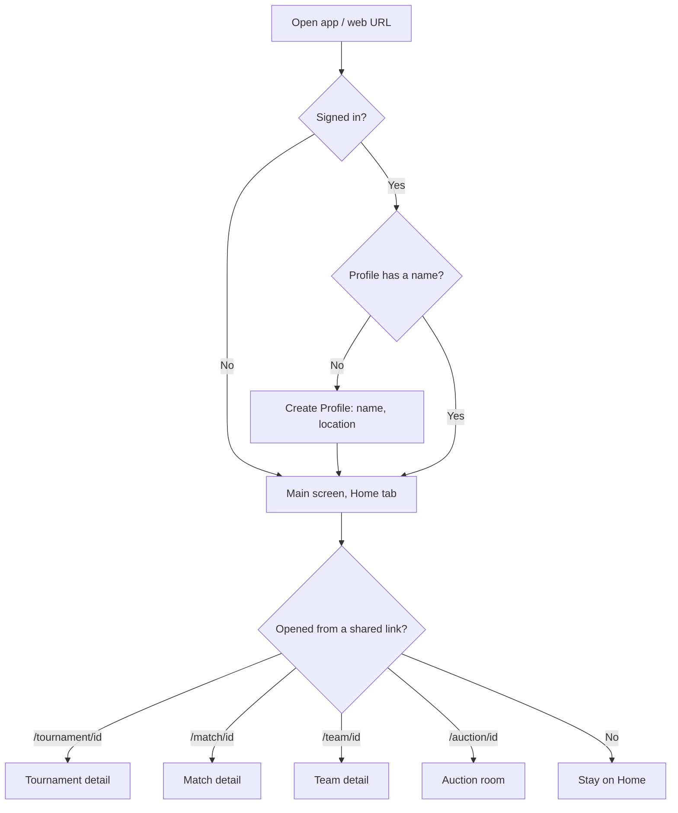
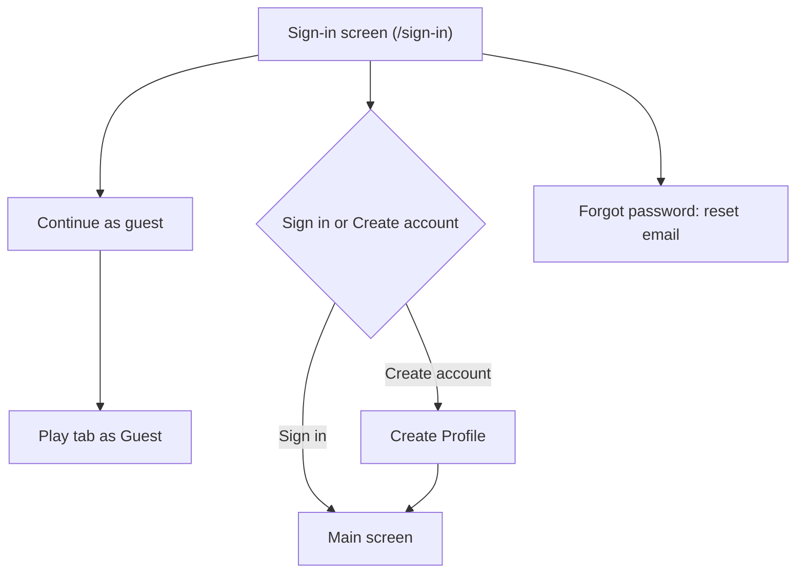

# Sports Tamil (Khelo) — Complete Technical & Product Context

> **Unified Vault Handbook:** Consolidated master context compiled from all technical specification documents in `vault/`.
> **Project:** Khelo / Sports Tamil 🏏 | **Tech Stack:** Flutter, Dart, Firebase Firestore, Riverpod, GoRouter

---

## Master Table of Contents

- [1. Project Overview & Architecture Index](#1-project-overview-architecture-index)
- [2. System Architecture & Monorepo Design](#2-system-architecture-monorepo-design)
- [3. App Flow, Navigation & Role-Based Access](#3-app-flow-navigation-role-based-access)
- [4. Design System, Theming & Brand Identity](#4-design-system-theming-brand-identity)
- [5. Firestore Database Architecture & Schema](#5-firestore-database-architecture-schema)
- [6. Authentication, Sessions & Guest Access](#6-authentication-sessions-guest-access)
- [7. Profile Creation, Privacy & Storage](#7-profile-creation-privacy-storage)
- [8. Splash Screen & Brand Intro Animation](#8-splash-screen-brand-intro-animation)
- [9. Home Screen & Live Feed Architecture](#9-home-screen-live-feed-architecture)
- [10. My Cricket Hub (Matches, Teams, Tournaments)](#10-my-cricket-hub-matches-teams-tournaments)
- [11. Match Rules & Scoring Engine Logic](#11-match-rules-scoring-engine-logic)
- [12. Tournament Creation & Settings](#12-tournament-creation-settings)
- [13. Tournament Page, Standings, NRR & MVP Calculations](#13-tournament-page-standings-nrr-mvp-calculations)
- [14. Tournament Teams & Pool Management](#14-tournament-teams-pool-management)
- [15. Live Player Auction Engine & Roster Generation](#15-live-player-auction-engine-roster-generation)
- [16. Play Mini-Game, 1v1 Multiplayer & Leaderboards](#16-play-mini-game-1v1-multiplayer-leaderboards)
- [17. Player Claim System & Phone Number Indexing](#17-player-claim-system-phone-number-indexing)
- [18. Sports Tamil Tiger Mascot & Tamil Dialogue Guide](#18-sports-tamil-tiger-mascot-tamil-dialogue-guide)
- [19. Profile Screen & User Settings](#19-profile-screen-user-settings)
- [20. Local Development Setup & Tooling](#20-local-development-setup-tooling)
- [21. Production Deployment & VPS Infrastructure](#21-production-deployment-vps-infrastructure)
- [22. Comprehensive QA Testing Checklist](#22-comprehensive-qa-testing-checklist)
- [23. Known Issues, Technical Debt & Open Workarounds](#23-known-issues-technical-debt-open-workarounds)

---

## 1. Project Overview & Architecture Index

Cricket management app (teams, players, matches, live scoring, tournaments), forked from the open-source Khelo app and rebranded as **Sports Tamil**.

- Live web app: https://sportstamil.network (VPS) · https://khelo-hexshankar.web.app (Firebase Hosting)
- Local dev: http://127.0.0.1:8090

### Start here
- [App Flow](#3-app-flow-navigation-role-based-access) — landing flow, sign-in, tabs, every role and what it can do
- [Architecture](#2-system-architecture-monorepo-design) — modules, state management, routing
- [Dev Setup](#20-local-development-setup-tooling) — run locally, code generation, lint
- [Deployment](#21-production-deployment-vps-infrastructure) — Firebase Hosting
- [Firestore Data Model](#5-firestore-database-architecture-schema) — collections and key fields
- [Design System](#4-design-system-theming-brand-identity) — navy / red / white palette from the logo, logo files, app icons, cards, home styling

### Features
- [Home Screen](#9-home-screen-live-feed-architecture) — greeting header, red live match hero cards with the chase and run rates, compact upcoming / result cards
- [Splash Screen](#8-splash-screen-brand-intro-animation) — animated intro from the brand splash pack: red screen, navy stroke sweep, spinning bars into the rings, text and swoosh
- [Tournament Teams](#14-tournament-teams-pool-management) — team pools per series (GCPL, PSPL), their teams and players, and the pool-based team picker in Create Tournament
- [Create Tournament](#12-tournament-creation-settings) — tournament form with mandatory city, ground, ball type and overs per match, shown on the Overview tab
- [Tournament Page](#13-tournament-page-standings-nrr-mvp-calculations) — animated tournament page: navy hero, champions, match cards, points table with NRR and form, batting / bowling / fielding / records / MVP stats, ranked team cards
- [Play](#16-play-mini-game-1v1-multiplayer-leaderboards) — timing-cricket game tab: stadium arena with sound and commentary, daily challenge, live 1v1 matches (request, toss, ball-by-ball watching), XP / levels / badges, leaderboard
- [Auction](#15-live-player-auction-engine-roster-generation) — public player auctions with live bidding, retained players and photos; completing one generates a tournament (Auction tab; Stats moved to Profile → My stats)
- [Match Rules](#11-match-rules-scoring-engine-logic) — balls per over, wide/no-ball rules, last man standing, mid-match edits
- [Authentication](#6-authentication-sessions-guest-access) — Firebase email + password
- [Create Profile](#7-profile-creation-privacy-storage) — required name and private mobile number after sign-in, optional photo stored inline, tiger prompts for missing fields
- [My Cricket](#10-my-cricket-hub-matches-teams-tournaments) — iOS-style tab: large title, Matches / Teams / Tournaments segmented control, grouped team list, tournament cards with chips, empty states with Create buttons
- [Profile Screen](#19-profile-screen-user-settings) — iOS Settings-style Profile tab: navy header card with photo, private mobile and Edit profile, grouped rows with coloured icon tiles, separate Sign out
- [Player Claim](#17-player-claim-system-phone-number-indexing) — find players by mobile number; an added player links to the real account after sign-up, with organizer approval
- [Mascot](#18-sports-tamil-tiger-mascot-tamil-dialogue-guide) — the tiger guide speaks Sri Lankan Tamil: greets by name, helps with sign-in, and reacts to sixes, wickets, results, Play shots, auctions and empty screens; tap it for movie lines (text in `app_ta.arb`)

### Working notes
- [Testing Checklist](#22-comprehensive-qa-testing-checklist)
- [Known Issues](#23-known-issues-technical-debt-open-workarounds)

---

## 2. System Architecture & Monorepo Design

### Modules (monorepo)
| Folder | Purpose |
|---|---|
| `khelo/` | Flutter app: UI, routing, view models, localization |
| `data/` | Models (`data/lib/api/*`), Firestore services (`data/lib/service/*`), constants, errors |
| `style/` | Shared design system: buttons, text styles, colors, indicators (see [Design System](#4-design-system-theming-brand-identity)) |

### Patterns
- **State management:** Riverpod `StateNotifier` + a state class per screen (`*_view_model.dart` next to `*_screen.dart`).
- **Models:** mostly `freezed` + `json_serializable`. `build_runner` is currently broken, so newer models (e.g. [Tournament Teams](#14-tournament-teams-pool-management)) are plain Dart classes with hand-written `copyWith`.
- **Routing:** GoRouter via `khelo/lib/ui/app_route.dart`. An `AppRoute` passes its screen builder through `extra`, so deep links to pushed routes don't work. Exception: `/auction/:id` builds `AuctionRoomScreen` from the path when `extra` is missing, so auction links can be shared (see [Auction](#15-live-player-auction-engine-roster-generation)). [Play](#16-play-mini-game-1v1-multiplayer-leaderboards) adds `/play-game` and `/play-match` (`AppRoute.playMatch(matchId)`).
- **Public (signed-out) access:** the Auction tab and auction rooms work without signing in; Firestore rules allow public reads of published auctions, their `log` and `photos`. Everything else still needs sign-in.
- **Errors:** services throw `AppError` with an l10n code (`data/lib/errors/app_error_l10n_codes.dart`), mapped to user-facing strings in `khelo/lib/domain/extensions/app_error_extension.dart`.
- **Localization:** `khelo/assets/locales/app_en.arb` → `flutter gen-l10n`. `app_ta.arb` holds only the tiger's Tamil lines; the app UI stays English because `supportedLocales` is pinned to `en` in `khelo/lib/ui/app.dart`. The [Mascot](#18-sports-tamil-tiger-mascot-tamil-dialogue-guide) reads Tamil via `lookupAppLocalizations(Locale('ta'))`.
- **Startup:** `main.dart` shows `SplashScreen`, then waits for both Firebase / container setup and the splash animation's minimum time before running `App` (see [Splash Screen](#8-splash-screen-brand-intro-animation)).
- **App-wide overlay:** `MaterialApp.router` / `CupertinoApp.router` `builder:` wraps every screen in `MascotOverlay`; screens call `ref.read(mascotProvider.notifier).show(...)` (see [Mascot](#18-sports-tamil-tiger-mascot-tamil-dialogue-guide))
- **Raw Firestore fields beside freezed models:** fields that freezed models can't gain (because `build_runner` is broken) are read separately from the raw docs: `TournamentDetails`, and for the [Tournament Page](#13-tournament-page-standings-nrr-mvp-calculations) `MatchExtras` / `TeamExtras` (`data/lib/api/tournament/tournament_extras.dart`) and users' `photo_id`. The tournament page combines them in Riverpod providers (`detail/summary/tournament_summary_provider.dart`) instead of the freezed `TournamentDetailState`.
- **Loading match lists:** list queries in `MatchService` pass their docs to `_withTeams`, which collects every team id and squad player id in the list and loads them in one batched `getTeamsByIds` + `getUsersByIds` (both query 30 ids at a time in parallel). Don't load teams per match in new list queries. Single-match loaders still use `getTeamsList`
- **Loading states:** full-page loads show shimmer skeletons (`style/lib/indicator/shimmer.dart`, see [Design System](#4-design-system-theming-brand-identity)); `AppProgressIndicator` is kept for small inline spinners (buttons, "load more", uploads, bottom sheets) and the Match flow screens
- **Assets:** `khelo/lib/gen/assets.gen.dart` has no generator wired into `pubspec.yaml`; new assets are added by hand in the same generated style.

### UI flows
`khelo/lib/ui/flow/` — `home`, `matches`, `score_board`, `team`, `tournament`, `stats`, `play`, `auction`, `leaderboard`, `profile`, `sign_in`, `settings`, …

### Bottom navigation
- Tabs: Home, My Cricket, Play, Auction, Profile (`khelo/lib/ui/flow/main/main_screen.dart`); Play and Auction use Cupertino icons (`_tabIcon`) instead of SVG assets. See [Play](#16-play-mini-game-1v1-multiplayer-leaderboards), [Auction](#15-live-player-auction-engine-roster-generation)
- The tabs are wrapped in `PlayInviteListener` (`flow/play/match/play_invite_listener.dart`). It writes Play presence every 60 s and pops up live match requests on any screen. See [Play](#16-play-mini-game-1v1-multiplayer-leaderboards)
- Stats is no longer a tab: Profile → **My stats** pushes `AppRoute.userStats()` (`UserStatScreen(showTitle: true)`)
- Web and Android use `AppBottomNavigationBar` (`style/lib/navigation/bottom_navigation_bar.dart`): a floating navy pill bar (`brandNavyBarColor`), red rings logo (`app_logo_mark.svg`) in a white circle on the left, selected tab icon in a glowing red circle with a bold label; unselected tabs are white at 75%. Framer-style motion: one red indicator springs between tabs (`AnimatedPositioned`, `easeOutBack`, like Framer Motion's shared `layoutId`), the selected icon lifts and grows 12%, icon colour and label weight fade, a pressed tab squishes to 90%, and the bar slides up on first show (`FadeSlideIn`). All skipped when reduced motion is on. Colours: [Design System](#4-design-system-theming-brand-identity)
- `leading` param takes the logo; tab icons are passed in `onPrimary` (`_tabItems(onPrimaryBar: true)`) and tinted by the bar
- Each tab exposes a semantics tap action (screen readers and web accessibility work)
- iOS still uses the native `CupertinoTabBar`

### Backend
- **Firestore** — all app data, see [Firestore Data Model](#5-firestore-database-architecture-schema)
- **Firebase Auth** — see [Authentication](#6-authentication-sessions-guest-access)
- **Supabase storage** — image uploads (team logos, profile images); currently offline, see [Known Issues](#23-known-issues-technical-debt-open-workarounds)
- **Auction photos** are stored in Firestore (`photos` collection, ~480px JPEG), not Supabase

---

## 3. App Flow, Navigation & Role-Based Access

How the app behaves from the moment it opens, what each kind of user can see and do, and where those checks live. Feature detail is in each feature note; this note is the map.

### 1. Opening the app (landing flow)



- Decided once at start-up in `khelo/lib/ui/app.dart` (`hasUserSession`, `currentUserPod`)
- There is no forced login screen: signed-out visitors land on Home
- Shared links for tournament, match and team go through `khelo/lib/ui/flow/app_links/app_links_handler.dart` (opens Main, then pushes the detail). `/auction/:id` is a real route (see [Auction](#15-live-player-auction-engine-roster-generation))

### 2. Bottom tabs

| Tab | Signed out | Signed in |
|---|---|---|
| Home | Yes | Yes |
| My Cricket | "Sign in to continue" | Matches, Teams, Tournaments |
| Play | "Sign in to continue", or play as **Guest** | Yes |
| Auction | Yes (published auctions) | Yes, plus **My auctions** |
| Profile | "Sign in to continue" | Yes |

- Code: `khelo/lib/ui/flow/main/main_screen.dart` (`SignInRequiredView` for locked tabs)
- Home quick actions (**Add team**, **Add match**, **Add tournament**) send signed-out users to sign-in first (`_pushWhenSignedIn` in `home_screen.dart`)

### 3. Sign-in flow



- Screen: `sign_in/sign_in_screen.dart` (route `/sign-in`; email + password only)
- Service: `data/lib/service/auth/auth_service.dart` (`signInWithEmail`, `sendPasswordResetEmail`, `signInAsGuest`, `signOut`, `deleteAccount`)
- Sign out / delete account: Profile → settings. Signing out returns to Main
- More: [Authentication](#6-authentication-sessions-guest-access)

### 4. Roles

There is no global "admin" in the app. Every role is **per item** (a team, match, tournament or auction) and comes from fields on that document.

| Role | How you get it | Stored in |
|---|---|---|
| Guest | Not signed in | — |
| User | Signed in with a completed profile | `users/{uid}` |
| Team owner | Created the team | `teams.created_by` |
| Team admin | Owner made you admin | `teams.players[].role = admin` |
| Team player | Added to the team | `teams.players[]` |
| Match creator | Created the match | `matches.created_by` |
| Match officials | Picked when adding a match | `umpire_ids`, `scorer_ids`, `commentator_ids`, `referee_id` |
| Tournament owner | Created the tournament | `tournaments.created_by` |
| Tournament organizer / admin | Added as a member | `tournaments.members[].role` |
| Auction creator | Created the auction | `auctions.created_by` |
| Auction co-admin | Added by the creator | `auctions.admin_ids` |
| Pool / auction player | Added by an organizer, no login | `users` doc without an account |

### 5. What each role can do

#### Guest (signed out)
- Home: live / upcoming / finished matches and recent tournaments (5 per row: newest first, upcoming soonest first; "View all" for the rest), leaderboards, search
- Open match, team and tournament details from Home or a shared link (read-only)
- Auction tab: Live, Upcoming and Completed auctions; watch an auction room live, including budgets if the auction shows them
- Can't create anything; My Cricket, Play and Profile ask to sign in
- **Continue as guest** (on the sign-in screen) unlocks only Play: quick play, daily challenge and the leaderboard, with scores saved as "Guest" ([Play](#16-play-mini-game-1v1-multiplayer-leaderboards))

#### User (signed in)
- Everything a guest can do
- Create teams, matches and tournaments (they become the owner / creator)
- **My Cricket**: their matches, teams (pool teams hidden) and tournaments, plus the **Tournament Teams** pools card ([Tournament Teams](#14-tournament-teams-pool-management))
- **Play**: quick play, daily challenge, 1v1 challenges, leaderboard ([Play](#16-play-mini-game-1v1-multiplayer-leaderboards))
- **Auction**: create an auction (they become its creator and first admin)
- **Profile**: edit profile, My stats, QR code ("scan to play"), contact support, share / rate app, sign out, delete account

#### Team owner and team admin
- See the ⋯ menu on the team page: edit team, add / remove members, make admin (`team.isAdminOrOwner`, `team/detail/team_detail_screen.dart`)
- Add players by search or QR scan (`AppRoute.addTeamMember`, `scannerScreen`)
- Team player (not admin): appears in the squad and stats, can't edit the team

#### Match creator
- On My Cricket → Matches, only the creator sees **Edit** and **Resume scoring** on a match card (`match.created_by == currentUserId` in `matches/match_list_screen.dart`)
- Runs the match flow: Add match → squads → officials → power play → toss → score board ([Match Rules](#11-match-rules-scoring-engine-logic))
- Officials (umpires, scorers, commentators, referee) are shown on the match info tab; they don't get extra buttons in the app

#### Tournament owner, organizer and admin
- Any member (owner, organizer or admin) sees the ⋯ menu on the tournament page, can select teams and schedule / add matches (`tournament/detail/tournament_detail_screen.dart`, `tabs/tournament_detail_teams_tab.dart`, `tabs/tournament_detail_matches_tab.dart`)
- Only the **owner or an organizer** can edit the tournament's fields (name, type, overs, ball type, teams…) in the edit form (`isOrganizer` in `tournament/add/add_tournament_screen.dart`)
- Members screen (`tournament/detail/members/`):
  - Owner: make admin, make organizer, remove member, transfer ownership (on self)
  - Organizer: make admin or remove a non-admin member
  - Admin: can only leave (remove self)
- Tournaments are created from a team pool ([Create Tournament](#12-tournament-creation-settings), [Tournament Teams](#14-tournament-teams-pool-management))

#### Auction creator and co-admin
- **Creator**: everything below, plus changing the co-admin list and deleting the auction
- **Co-admin**: edit details, players, photos and retained players during setup; run the live room (show player, start bidding, bid, undo last bid, sell / unsold, pause / resume); complete the auction, which creates a tournament with teams and players
- **Viewer** (anyone, signed in or not): watches the room live; drafts are hidden from viewers
- Full detail: [Auction](#15-live-player-auction-engine-roster-generation)

#### Pool and auction players (no login)
- Created by organizers in [Tournament Teams](#14-tournament-teams-pool-management) or by completing an [Auction](#15-live-player-auction-engine-roster-generation)
- Appear in squads, matches and stats like normal players, but can't sign in and are hidden from the Play opponent search

### 6. End-to-end journeys

#### Organizer runs a tournament from an auction

```mermaid
flowchart LR
    A[Create auction] --> B[Add teams, players, photos]
    B --> C[Retain players]
    C --> D[Publish: upcoming]
    D --> E[Go live: bid, sell, unsold]
    E --> F[Complete auction]
    F --> G[Tournament + team pool + teams + players created]
    G --> H[Schedule matches in the tournament]
    H --> I[Score matches live]
    I --> J[Stats and leaderboards update]
```


#### Organizer runs a tournament without an auction
- Tournament Teams → create a pool → add teams and players
- Home → **Add tournament** → pick the pool and teams, city, ground, ball type, overs
- Tournament page → Matches → add / schedule → score each match

#### Casual match
- Home → **Add match** → pick two teams (or create them) → squads, officials, toss → score board → result

#### Fan / visitor
- Open the web app or a shared link → follow live scores, tournaments and auctions without signing in

### 7. Where permissions are enforced

- **Firestore rules** (`khelo/firestore.rules`):
  - Public read: matches, teams, tournaments, innings, ball scores, match events, partnerships, leaderboard, users and user stats
  - Auctions: published ones are public, drafts are admin-only; only admins write; only the creator changes admins or deletes. Same for auction `log` and `photos`
  - **Everything else: any signed-in user can write.** Team, match and tournament roles are only checked in the app's UI, not by the database
- **UI checks**: the `created_by` / `isAdminOrOwner` / `members` checks listed in section 5
- **Cloud Functions** (`khelo/functions/src/index.js`): team player change notifications, user stat → leaderboard updates, a 5-minute cron, and an `apiv1` HTTP API (create auth user)

### Open items
- [ ] Add Firestore rules for team / match / tournament roles so a signed-in user can't edit other people's data by calling the database directly (see [Known Issues](#23-known-issues-technical-debt-open-workarounds))
- [ ] Confirm which Cloud Functions are actually deployed on `khelo-hexshankar`

Related: [Architecture](#2-system-architecture-monorepo-design), [Authentication](#6-authentication-sessions-guest-access), [Firestore Data Model](#5-firestore-database-architecture-schema), [Testing Checklist](#22-comprehensive-qa-testing-checklist)

---

## 4. Design System, Theming & Brand Identity

Visual style taken from the Sports Tamil logo: navy, red and white. Layout ideas (soft rounded cards, glowing icon circles, floating pill bottom bar) still come from the earlier "Cricket app UI" concept; only the colours changed to the logo's.

### Where in the app
- Every screen picks up the palette through `context.colorScheme` (`AppColorScheme`)
- Home screen: greeting header with the logo mark, red live match hero cards, compact white upcoming / result cards, quick-action chips, tournament cards (see [Home Screen](#9-home-screen-live-feed-architecture))
- Bottom navigation bar (see [Architecture](#2-system-architecture-monorepo-design) → Bottom navigation)
- [Splash Screen](#8-splash-screen-brand-intro-animation) and all app icons use the same colours

### Rules
- **Brand colours:** navy `#010127` (`brandNavyColor`), red `#F9151D` (`brandRedColor`), deep red `#B30A12` (`brandRedDeepColor`), white
- **Light mode:** cool light-grey background `#F3F3F8`, white cards, navy text, red primary (buttons, links, selected things)
- **Dark mode:** navy background `#010127`, navy cards `#12124A`, white text, red primary
- **Green** (`positiveGreenColor` `#22C55E`) is only for success meanings: sold players, completed auctions, fours / sixes, "done" steps. Don't use it as decoration
- **Info** is blue (`#2F4FD8` light / `#8FA2FF` dark); **warning** orange `#FF9F0A`; **alert** is the brand red
- Live cards use `liveCardGradient` (red → deep red) with white text
- Decorative icon circles are red with a white icon (Home quick actions, bottom bar selected tab); on a red card they get a white ring (Play) or turn white with a red icon (Auction hero)
- Tournaments without a banner: navy gradient + red circle + white trophy
- App bars use the screen background colour (no white strip); iOS nav bars use it at 95% opacity
- Cards: `cs.card` + `cs.cardShadow`, `cardDecoration()` default radius 14; home cards use 18
- Settings-style lists (Profile tab) follow iOS inset grouped lists: uppercase grey section captions, white rounded cards, 30 px coloured icon tiles with white icons, thin dividers that start after the icon, chevrons on tappable rows, and sign out as its own card in red text. See [Profile Screen](#19-profile-screen-user-settings)
- Shared iOS pieces live in `khelo/lib/components/grouped_list.dart`: `SectionCaption` (uppercase caption), `IconTile`, `BrandHeroCard` (navy gradient + red glow; used on Auction), `BrandIconThumb` (navy tile with red corner glow, stands in for missing images), `InfoChip` (small grey pill), `BrandEmptyState` (icon tile + title + red Create button). Used by [My Cricket](#10-my-cricket-hub-matches-teams-tournaments) and [Auction](#15-live-player-auction-engine-roster-generation)
- Tab headers: My Cricket uses a large bold title with a subtitle, round action buttons (red filled for +, white for filters) and an iOS segmented control (white thumb on grey)
- Match flow screens (add match, scoring, scoreboard, match rules) only change colour; their layout is untouched
- **Motion** (tournament pages, see the `/framer` skill and [Tournament Page](#13-tournament-page-standings-nrr-mvp-calculations)): staggered fade-slide entrances (`FadeSlideIn` + `AppStagger`, 40 ms steps, max 8), count-up numbers (`CountUp`), growing bars (`GrowBar`, or `GrowIn` for stacked bars), `OnTapScale` on tappable cards, `AnimatedSwitcher` for filter changes. Timing only from `AppAnimations`; all of it is skipped when the device asks for reduced motion
- **Loading = shimmer skeletons, not spinners.** Full-page loads show grey placeholder shapes with a soft white highlight sweeping across (1.4 s loop). They are static when reduced motion is on, and screen readers hear a single loading label. Pick the shape that matches the content: `SkeletonCards` for match / tournament / auction lists, `SkeletonList` for people and team lists, `SkeletonDetail` for profile and detail pages. Home has its own skeleton (live card, quick actions and two card rows). Use `AppProgressIndicator` only for small inline spinners
- The bottom navigation bar uses the same motion style: a sliding spring indicator, icon pop and press squish (see [Architecture](#2-system-architecture-monorepo-design) → Bottom navigation)
- Tournament hero, champion and leader cards are navy gradients with a soft red circle and white text; ranks 1–4 and points are red; green only for wins in form dots and the "Result" pill
- Auction team colours (`auction_widgets.dart`) are a separate list so teams stay distinguishable; it still includes indigo / pink / mint on purpose

### Logo
- Home header: red rings `assets/images/app_logo_mark.svg` in a white circle next to the greeting
- Text-only logo `assets/images/app_logo_wordmark.svg` ("Sports, தமிழ்." with the red comma, dot and swoosh; no rings) is no longer on Home. Its text uses `currentColor` (set through `SvgTheme`) if it's used again
- Bottom bar: red rings only (`assets/images/app_logo_mark.svg`) in the white circle
- App icons: red rings on navy. iOS `AppIcon.appiconset`, Android `mipmap-*` (legacy, round and adaptive foreground; adaptive background is solid navy in `drawable/ic_launcher_background.xml`), web `icons/` + `favicon.png`
- Android notification icon `drawable-xxxhdpi/khelo_logo.png`: white rings on transparent
- Old logo files (`app_logo_text.png`, `app_logo_splash.png`, `ic_app_logo.svg`, `web/splash_logo.png`, `app_logo_lockup.svg`) were removed
- Icon images were made from the traced logo SVG paths with headless Chrome + PIL (masters live only on the dev machine; re-trace from the original logo image if needed)

### Mascot
- The tiger (navy polo with red trim) is the brand character; pose images live in `assets/images/mascot/`. Speech bubbles use `cs.surface` with a red accent bar. See [Mascot](#18-sports-tamil-tiger-mascot-tamil-dialogue-guide)

### Code
- Palette and themes: `style/lib/theme/colors.dart`
- Card colour/shadow helpers: `style/lib/theme/shadows.dart`
- Shimmer and skeletons: `style/lib/indicator/shimmer.dart` (`AppShimmer`, `SkeletonBox`, `SkeletonList`, `SkeletonCards`, `SkeletonDetail`)
- Motion helpers: `style/lib/animations/motion.dart` (`AppStagger`, `CountUp`, `GrowBar`, `GrowIn`), `fade_slide_in.dart`, `on_tap_scale.dart`, `app_animations.dart`
- App bar background: `khelo/lib/components/app_page.dart`; iOS nav bar: `style/lib/widgets/custom_cupertino_navigation_bar.dart`, `khelo/lib/ui/app.dart`
- Home: `khelo/lib/ui/flow/home/home_screen.dart`, `components/live_match_card.dart`, `components/match_item.dart`, `components/tournament_item.dart`
- Profile tab: `khelo/lib/ui/flow/profile/profile_screen.dart`
- Bottom bar: `style/lib/navigation/bottom_navigation_bar.dart`; logo inside it: `khelo/lib/ui/flow/main/main_screen.dart`
- Web theme colour: `khelo/web/manifest.json` and `<meta name="theme-color">` in `khelo/web/index.html` (navy)

### Open items
- Dark mode not checked visually in the browser yet
- Red is both the primary colour and the error colour, so error text looks like links; change `awarenessAlertColor` if this is confusing
- Some screens still use hard-coded colours and were left as is; the sign-in screen now uses only the shared tokens (`containerLow` fields and pill switch, `primary` button and focus border, `positive` for the password rule)
- New app icons not yet checked on a real Android / iOS home screen

---

## 5. Firestore Database Architecture & Schema

Constants: `data/lib/utils/constant/firestore_constant.dart`

### Collections
| Collection | Holds |
|---|---|
| `users` | Users and players (including players created without an account; those added with a number have `created_by` = the organizer). No mobile numbers here (they live in `user_private` / `phone_index`). `profile_img_url` can be a normal URL or an inline `data:image/jpeg;base64,...` photo (256 px, see [Create Profile](#7-profile-creation-privacy-storage)) |
| `user_private` | One doc per player (doc id = uid): `phone` (`+<country><digits>`), `updated_at`. Only the owner can read or write it ([Create Profile](#7-profile-creation-privacy-storage)) |
| `phone_index` | Doc id = `sha256('sportstamil:' + number)`; `user_id` (who has that number), `created_by`, `updated_at`. Exact get only, no listing; only the owner or creator can change it ([Player Claim](#17-player-claim-system-phone-number-indexing)) |
| `player_claims` | Doc id = `<playerId>_<claimantId>`: `player_id`, `player_name`, `claimant_id`, `claimant_name`, `organizer_id`, `status` (pending / approved / declined / dismissed), `phone_key`, `created_at`, `updated_at`. Readable by the claimant and organizer; only the organizer approves or declines ([Player Claim](#17-player-claim-system-phone-number-indexing)) |
| `teams` | Teams, including [Tournament Teams](#14-tournament-teams-pool-management) pool teams |
| `matches` | Matches; subcollection `match_settings/setting`. Has `rules` (see [Match Rules](#11-match-rules-scoring-engine-logic)) |
| `innings`, `ball_scores`, `partnerships`, `match_events` | Live scoring data |
| `team_pools` | [Tournament Teams](#14-tournament-teams-pool-management) pools ("GCPL Teams", "PSPL Teams") |
| `tournaments` | Tournaments: `team_ids`, `match_ids`, `members`, dates, type, optional `pool_id`, and (see [Create Tournament](#12-tournament-creation-settings)) `city`, `ground`, `ball_type` (int, same values as match `BallType`: 1 leather, 2 tennis, 3 other), `overs_per_match` (int 1–50) |
| `team_stat`, `user_stat`, `leaderboard` | Aggregated stats |
| `user_sessions`, `contact_support` | Sessions, support tickets |
| `play_games` | [Play](#16-play-mini-game-1v1-multiplayer-leaderboards) game results, one doc per finished innings |
| `play_challenges` | [Play](#16-play-mini-game-1v1-multiplayer-leaderboards) old async 1v1 challenges (no new ones are created) |
| `play_matches` | [Play](#16-play-mini-game-1v1-multiplayer-leaderboards) live 1v1 matches, from request to result |
| `play_presence` | [Play](#16-play-mini-game-1v1-multiplayer-leaderboards) who has the app open (doc id = user id) |
| `auctions` | [Auction](#15-live-player-auction-engine-roster-generation) — one doc per auction (details, rules, teams, players, live state); subcollection `log` |
| `photos` | [Auction](#15-live-player-auction-engine-roster-generation) player and banner photos (compressed JPEG bytes) |

### Profile and number rules
Tested in the emulator (`khelo/firestore_rules_test`, see [Dev Setup](#20-local-development-setup-tooling)).
- `users/{id}`:
  - Anyone can read.
  - A signed-up account (no `created_by`) can only be created, edited or deleted by itself.
  - Organizer-added players (`created_by` set) can be created only with `created_by` = yourself, edited by any signed-in user (team roles aren't checkable), and deleted only by that organizer. Nobody can change `created_by`.
  - Auction players (`auction_id` set) can only be written by that auction's admins.
- `users/{id}/user_stat`, `user_session`: any signed-in user (scorers update other players' stats).
- `phone_index`:
  - A new entry may only point at yourself, or at a player you created in the same batch or earlier. Only `user_id`, `created_by` and `updated_at` are allowed.
  - It moves to another account only in the same batch that approves that player's claim.
  - If the player it points at no longer exists (deleted or merged away), it may be repointed like a new entry.
- `player_claims`:
  - Creating one needs the number's index key (it must point at that player), and `organizer_id` must be the player's `created_by`.
  - Only the organizer changes it, only from pending, and only `status` / `updated_at`.
- `storage.rules` (Firebase Storage is unused; uploads go to Supabase, and the file isn't in `firebase.json`): only `images/<uid>/…`, writable by that user.

### Play fields
**`play_games` doc:**
- `id`, `user_id`, `user_name`, `user_image`
- `mode` (`solo` / `daily` / `challenge` / `match`), `seed`
- `runs`, `wickets`, `balls`, `fours`, `sixes`
- `target`, `won` (null = no result or a tie), `daily_date`, `challenge_id`, `created_at`
- Live-match games use id `<matchId>_<userId>`.

**`play_matches` doc:**
- **Basics:** `id`, `seed`, `overs`, `wickets`.
- **Players:** `host_id` / `host_name` / `host_image` (the sender), `guest_id` / `guest_name` / `guest_image`, and `participant_ids` (both, used for the query).
- **`status`:** `requested` → `toss` → `live` → `completed`, or `declined` / `cancelled`.
- **Toss:** `toss_call` (`heads` / `tails`), `toss_winner_id`, `batting_first_id`.
- **Innings:** `current_innings` (1 or 2), `innings_1` and `innings_2`. Each is a list of `{r: shot name, o: tap offset in ms or null}`, written whole by the batter's app after every ball.
- **Result:** `winner_id` (null = tie), `result_type` (`runs` / `wickets` / `tie` / `forfeit`), `margin`.
- **Timing:**
  - `last_seen.<userId>` is a server-time heartbeat every 10 s;
  - `created_at` uses the client time (a request expires 10 minutes after it);
  - `updated_at` uses the server time.

**`play_presence/{userId}` doc:** `user_id`, `name`, `image`, `last_seen` (server time, written every 60 s while the app is open by a signed-in user)

**Rules:**
- `play_matches` and `play_presence` use the "any signed-in user" catch-all, so no rules deploy was needed.
- Guests (anonymous) can't read or write them.

### Auction fields
**`auctions` doc:** `id`, `name`, `tournament_name`, `description`, `auction_date` (Timestamp), `banner_version` (0 = no banner), `created_by`, `admin_ids` (creator + co-admins), `created_at`, `status` (`draft` / `upcoming` / `live` / `paused` / `completed`), `team_budget`, `base_price`, `bid_increment`, `min_squad`, `max_squad` (0 = no limit), `show_budgets`, `current_player_id`, `bidding_open`, `bids` (current player only), `tournament_id` (set on completion), `completed_at`
- `teams: [{id, name, short_name, budget, logo_version (0 = no logo)}]`
- `players: [{id, name, code (player ID), number, role, base_price, status (available / retained / in_auction / sold / unsold), team_id, price (sold or retained price), order (queue position), photo_version (0 = no photo), user_id (linked profile, set from the mobile number; never the number itself)}]`
- `bids: [{team_id, amount}]` — bid trail for undo; cleared when the player is sold / unsold

**`auctions/{id}/log` doc:** `id`, `type` (created, published, started, paused, resumed, shown, biddingStarted, bid, bidUndone, sold, unsold, reopened, retained, released, completed), `player_id`, `team_id`, `amount`, `by`, `created_at`

**`photos/{id}` doc:** `data` (Blob, ~480px JPEG), `auction_id`, `created_by`, `updated_at`. A player's photo id = the player's id; the banner uses the auction's banner photo id; a team logo uses `team_<auctionId>_<teamId>` (256 px JPEG)

**Rules** (`khelo/firestore.rules`): auctions with status upcoming / live / paused / completed and all `photos` / `log` docs are readable by anyone, signed in or not; drafts only by admins. Only admins write; only the creator changes `admin_ids` or deletes. Auction player docs (`users/auction_…`) can only be written by that auction's admins. Every other collection keeps "any signed-in user", except `users`, `user_private`, `phone_index` and `player_claims` (see the rules section below)

**Generated on completion** (all carry `auction_id`):
- `tournaments/auction_<auctionId>` — normal tournament fields, `match_ids: []`, `pool_id`, `schedule_status: "not_scheduled"`; `start_date` / `end_date` = auction date (required by the model)
- `team_pools/auction_<auctionId>`
- `teams/auction_<auctionId>_<teamId>` — pool team (`is_tournament_team`, `pool_id`, `team_players`)
- `users/auction_<auctionId>_<playerId>` — `name`, `player_role`, `jersey_number`, `photo_id` (→ `photos`), `auction_player_code`, `auction_status`, `auction_price`

Queries: `auctions where status in [...]`, `where admin_ids array-contains`; `photos where auction_id ==`. No composite indexes.

### Play fields
**`play_games` doc:** `id`, `user_id`, `user_name`, `user_image`, `mode` (`solo` / `daily` / `challenge`), `seed`, `runs`, `wickets`, `balls`, `fours`, `sixes`, `target` (daily / challenge reply), `won` (daily and challenge reply; null = tie or no target), `daily_date` (`yyyy-MM-dd`, daily only), `challenge_id`, `created_at` (Timestamp)

**`play_challenges` doc:** `id`, `seed`, `creator_id`, `creator_name`, `opponent_id`, `opponent_name`, `participant_ids` ([creator, opponent]), `creator_score` / `opponent_score` (`{runs, wickets, balls}`), `status` (`pending` / `completed`), `winner_id` (null = tie), `created_at`, `completed_at`

Queries: `play_games where user_id ==`, `where daily_date ==`, `where created_at >=`; `play_challenges where participant_ids array-contains`. All single-field, sorted in the app, so no composite indexes. Covered by the "signed-in can read/write" Firestore rule. Guests (anonymous sign-in) have their own `play_games` rule: read, and create only their own game with `user_name == 'Guest'`, `user_image == null`, `challenge_id == null`.

### Tournament Teams fields
**`team_pools` doc:**
- `id`, `name`, `name_lowercase` (spaces removed; unique per `created_by`), `short_name`, `logo`
- `created_by`, `created_at`
- `team_ids` (kept in sync with each team's `pool_id` via batched writes)

**`teams` doc (pool team):**
- `is_tournament_team: true`, `created_by`, `pool_id` (missing = "Ungrouped")
- `name`, `name_lowercase` (spaces removed; used for the uniqueness check), `name_initial` (short code), `profile_img_url` (logo)
- `captain_id`, `wicket_keeper_id`
- `team_players: [{id, role}]`
- `created_at`, `created_time`

**`users` doc (pool player):**
- `name`, `created_by`
- `player_role`, `batting_style`, `bowling_style` (enum int values)
- `jersey_number`
- `photo_id` (optional, players generated by an [Auction](#15-live-player-auction-engine-roster-generation); read into `TournamentTeamPlayer.photoId` and by the [Tournament Page](#13-tournament-page-standings-nrr-mvp-calculations) for player photos)

### Tournament page extra fields
Optional raw fields read beside the freezed models (`data/lib/api/tournament/tournament_extras.dart`); written by imports such as the SMPL seed, see [Tournament Page](#13-tournament-page-standings-nrr-mvp-calculations):
- `matches`: `match_number` (int, "Match 32"), `stage` (string: League, Qualifier 1, Eliminator, Qualifier 2, Final), `result_margin` (string, imported text; not shown), `walkover_winner_id` (team id; the match is `abandoned` and counts as a win for that team)
- `teams`: `owner_name` (team owner shown under the name), `color` (imported hex; not used for UI colours)

**Tournament ↔ Team:** many-to-many via `tournaments.team_ids`. Usage check: `tournaments where team_ids array-contains <teamId>` (`count()`).

**Pool usage:** `tournaments where team_ids array-contains-any <pool team ids>` in chunks of 30, counting distinct tournaments. Teams in a pool: `teams where pool_id == <poolId>`.

The pool query uses two equality filters (`created_by`, `is_tournament_team`), so no composite index is needed.

---

## 6. Authentication, Sessions & Guest Access

- **Method:** Firebase Auth **email + password** only (replaced the email-code flow, which depended on Supabase), with "Forgot password" reset email.
- WhatsApp login was **removed** (9 Nov 2026): it was never set up with Meta and its button messaged the owner's own number. The login service, its deploy script and the `/whatsapp-login` route are gone. Email-only sign-in screen live on https://sportstamil.network since 9 Nov 2026.

### Sign-in screen
- **Where in the app:** one screen at route `/sign-in` (`AppRoute.signIn`), opened from locked tabs ("Sign in"), Home quick actions, the intro screen, Play and Auction
- **Layout** (centred, max 440 px wide, same tokens as the rest of the app): wordmark logo → title + one-line description → **Sign in | Create account** pill switch → labelled Email and Password fields → "Forgot password?" (sign in) or the "At least 6 characters" rule that turns green (create account) → full-width red button → "or" → **Continue as guest** link with a short hint
- **Rules:**
  - Button turns on only for a valid email and a password of 6+ characters; fields are locked while it works
  - Browser / phone password managers are supported (`autofillHints`: email, password, new password)
  - Success → Main screen; new accounts then go to **Create Profile**
  - Errors are shown in plain English (wrong password, no account, email already used, weak password, too many attempts, account turned off, no internet)
  - The guest link is hidden when the device is already a guest
- **Code:** `khelo/lib/ui/flow/sign_in/sign_in_screen.dart`, `data/lib/service/auth/auth_service.dart` (`signInWithEmail`, `sendPasswordResetEmail`, `signInAsGuest`), `style/lib/text/app_text_field.dart` (`autofillHints`)
- **Tests:** `flutter test test/ui/sign_in` (no WhatsApp, button only on valid input, create-account rule, guest link)
- Full landing and role flow: [App Flow](#3-app-flow-navigation-role-based-access)
- Signed-in players without a name or mobile number are sent to [Create Profile](#7-profile-creation-privacy-storage) and must finish it before using the app (older accounts without a number see it once too).
- The tiger [Mascot](#18-sports-tamil-tiger-mascot-tamil-dialogue-guide) reacts on the sign-in and Create Profile screens (intro, valid email, password privacy, wrong password → Forgot password hint, reset sent, success, name greeting).
### Guest (Play only)
- **Continue as guest** on the sign-in screen uses Firebase **anonymous** sign-in (`AuthService.signInAsGuest`). The guest gets a Firebase uid, kept on the device, but no `users` doc, so `hasUserSession` stays false
- Guests can only use the [Play](#16-play-mini-game-1v1-multiplayer-leaderboards) tab; their scores are saved as "Guest"
- `firestore.rules`: `signedIn()` excludes anonymous users, so guests can't write anything else. They can read `play_games` and create their own games only with `user_name == 'Guest'`, no photo and no challenge
- Needs **Anonymous** enabled in Firebase Console → Authentication → Sign-in method (not enabled yet as of 9 Nov 2026)
- Players can also be created **without verification** (no account), e.g. pool players in [Tournament Teams](#14-tournament-teams-pool-management).

See [Known Issues](#23-known-issues-technical-debt-open-workarounds) for the Supabase dependency.

---

## 7. Profile Creation, Privacy & Storage

### Where in the app
- Route `/edit-profile` (`AppRoute.editProfile`). It opens in **create mode** (`isToCreateAccount: true`) and in **edit mode** from Profile → Edit.
- Create mode opens on its own whenever a signed-in player has no name or no mobile number. This covers new accounts, older accounts without a mobile number, and phone sign-in. The check runs in `MainScreen` (`profileIncompleteProvider`) and at app start in `app.dart`.
- Guests (anonymous sign-in) never see it. They stay Play-only with no profile (see [Authentication](#6-authentication-sessions-guest-access)).

### Layout
- Navy hero card with a 108 px photo (white ring, red camera badge), add / change / remove photo links, heading, and a progress bar counting the 9 filled items.
- **Basic details (required):** name, mobile number with a country picker (India by default; also Sri Lanka, Singapore, Malaysia, UAE, Saudi Arabia, Qatar, UK, USA/Canada, Australia), optional email and city.
- **Personal (optional):** date of birth and gender chips.
- **Cricket (optional):** role chips, batting chips, bowling style picker.
- Sticky red button at the bottom: **Create profile** or **Save changes**.
- Create mode also has a "Not you? Sign out" link. Edit mode has Delete account.
- Content is centred at a max width of 560 px and works from 320 px phones up to desktop.

### Rules
- Required: a **name** (at least 2 letters) and a **mobile number** that is valid for the chosen country (length, and the first digit for India and Sri Lanka). Spaces, dashes, the country code and a leading 0 are cleaned off.
- The mobile number is stored as `+<country><digits>` in the private `user_private/{uid}` doc, readable only by that player. It is **not** on the public `users` doc (see [Firestore Data Model](#5-firestore-database-architecture-schema)).
- On an empty or wrong submit, the first bad field is focused, the fields turn red with a message, and the tiger [Mascot](#18-sports-tamil-tiger-mascot-tamil-dialogue-guide) says what's missing (name, mobile, both, a wrong number or a wrong email).
- **Photo** is optional. Supabase storage is offline, so the photo is cropped to a square, resized to 256 px, saved as a JPEG of about 10–20 KB, and stored inline in `users.profile_img_url` as a `data:image/jpeg;base64,...` URL. Play docs never copy inline photos (they show initials instead).

### Code
- Screen: `khelo/lib/ui/flow/settings/edit_profile/edit_profile_screen.dart`
- State and save: `edit_profile_view_model.dart` (plain Dart class; no freezed)
- Gate: `profile_completion.dart` (`profileIncompleteProvider`, `isProfileComplete`), used in `khelo/lib/ui/flow/main/main_screen.dart`
- Phone rules: `khelo/lib/domain/phone/phone_number.dart`
- Photo: `khelo/lib/domain/image/profile_photo.dart`, `khelo/lib/components/app_image_provider.dart`, `image_avatar.dart`; the picker shrinks big photos (`ImagePickerSheet.show(maxDimension:)`)
- Private phone: `UserService.streamPrivatePhone` / `savePrivatePhone` in `data/lib/service/user/user_service.dart`. Saving also registers the number in `phone_index` (or triggers the "Is this you?" prompt); see [Player Claim](#17-player-claim-system-phone-number-indexing)
- Rules: `khelo/firestore.rules` (`match /user_private/{userId}`)
- Tests: `test/ui/profile/profile_rules_test.dart` (phone and completion rules) and `create_profile_screen_test.dart` (320 / 390 / desktop, no overflow, errors on an empty submit)

### Open items
- [x] Firestore rules deployed (9 Nov 2026): only the owner can read `user_private`
- [x] Live on https://sportstamil.network since 9 Nov 2026

---

## 8. Splash Screen & Brand Intro Animation

Animated Sports Tamil intro shown while the app starts. Design and artwork come from the provided `sports_tamil_flutter_splash.zip` (replaced the earlier calm SVG reveal on 9 Nov 2026).

### Where in the app
- Every platform (web, Android, iOS) plays the same Flutter animation once Flutter has loaded
- Before that, the web loading screen (`index.html`) and the native launch screens are **plain red** `#FB131A`, the animation's first colour, so the handoff is seamless

### Rules
- Colours: red `#FB131A`, navy `#010127`, white
- Sequence (5.8 s), then the finished logo holds for 0.6 s:
  1. A navy dot drops in and draws a ring (0–0.95 s)
  2. The ring shrinks and shoots up as a curved navy stroke (0.95–1.95 s)
  3. The stroke sweeps the whole screen navy (1.95–2.35 s)
  4. A red bar pair rises, splits into seven pairs, spins and gathers to the centre (2.35–4.4 s)
  5. The four red rings spin and pop into place (4.0–4.9 s)
  6. "Sports, தமிழ்." drops in as thin strips (4.5–5.5 s), then is drawn as one image so no seams show
  7. The red swoosh wipes in (5.0–5.6 s)
- `main.dart` keeps the splash up for at least 6.4 s (animation + hold); if the app is still loading after that, three pulsing white dots appear below the logo
- Logo size: 80% of the screen width, capped at 55% of the height and 420 px wide, so it fits phones, tablets and wide desktops
- "Reduce motion" (OS setting) skips the animation and shows the final logo straight away
- Artwork is PNG (rings, text, swoosh; about 200 KB), drawn on a canvas

### Code
- Flutter: `khelo/lib/ui/flow/splash/splash_screen.dart` (`SplashScreen`, `_SplashPainter`; positions are in the 1659×948 source artwork)
- Assets: `khelo/assets/splash/ring0-3.png`, `text.png`, `swoosh.png` (listed in `pubspec.yaml`)
- Web loading screen: `khelo/web/index.html` (`#splash` plain red, removed on `flutter-first-frame`)
- Native launch: Android `res/drawable*/launch_background.xml`, iOS `LaunchScreen.storyboard` background + `LaunchImage` (red)
- Startup wait: `khelo/lib/main.dart` waits for `_initContainer()` and `SplashScreen.minVisibleDuration` together
- Test: `khelo/test/ui/splash/splash_screen_test.dart`

### Open items
- [x] Deployed to the VPS (sportstamil.network), 9 Nov 2026
- [ ] Firebase Hosting still has an older build
- [ ] Not yet checked on a real Android / iOS device
- Android 12+ shows the system splash (app icon on the window background) before the Flutter one; not customised

---

## 9. Home Screen & Live Feed Architecture

The first tab. Its layout follows the "Scorio" cricket score app concept (Pinterest reference): greeting header, big live match card, compact upcoming cards. Colours stay the Sports Tamil navy / red / white (see [Design System](#4-design-system-theming-brand-identity)).

### Where in the app
- Bottom bar → **Home** (first tab)
- Top to bottom:
  - **Header:** red logo mark in a white circle, "Good morning / afternoon / evening!" and the player's name ("Guest mode" when signed out or a guest). A round search button sits on the right once there are matches.
  - **Live matches (N):** a red dot title and a red hero card per running match, swipeable with page dots.
  - **Quick actions:** Create team / match / tournament pills.
  - **Upcoming matches:** horizontal compact cards.
  - **Tournaments.**
  - **Recent results:** compact cards with the result line.
  - **Leaderboard.**
- Each section shows up to 5 items; **View all** opens the full list.

### Rules
- **Live hero card:**
  - "● LIVE" pill, "{N} overs match · ground", and a white arrow button.
  - Both teams side by side with a VS badge. The batting team gets a small bat badge. A score is shown once a team has batted, else "—".
  - The status strip shows, in order of priority: "X need N runs in M balls" (second innings) → "X batting" → "X won the toss" → "Match about to start".
  - Pills show CRR, RRR and Target when known.
- **Innings order:** comes from the toss (winner chose bat → bats first). With no toss yet, the listed team order is used.
- **Chase:**
  - target = first-innings runs + 1 (or the revised target);
  - balls left = overs × balls per over − balls faced (or the revised overs);
  - Test matches never show a chase.
- **Wickets:** a match team's `wicket` field counts wickets that team *took*. A batting side's score is therefore its runs / the opponent's `wicket`.
- **Upcoming card:** both teams, then "Today" / "Tomorrow" / date in red with the time, and the ground at the bottom.
- **Result card:** scores under each team, then "X won by N runs / wickets" or "Match tied". Abandoned matches show the ground.
- **Loading:** while the first data loads, Home shows a shimmer skeleton in the shape of the page (see [Design System](#4-design-system-theming-brand-identity)) instead of a spinner. It still waits for all five streams (live, upcoming, finished, tournaments, leaderboard) before showing content
- **Screen sizes:**
  - Content is a centred column of at most 960 px on tablets and desktop.
  - Phones show one live card per page. Wider screens show about 460 px cards side by side.
  - Text scaling is off inside cards so they keep their height.

### Code
- Screen: `khelo/lib/ui/flow/home/home_screen.dart` (`_greeting`, `_sectionHeader(live:)`, `_matchRow`)
- Live card and carousel: `khelo/lib/ui/flow/home/components/live_match_card.dart` (`LiveMatchCard`, `LiveMatchCarousel`, `LiveBadge`)
- Compact card: `khelo/lib/ui/flow/home/components/match_item.dart` (`MatchItem`)
- Innings / chase maths: `khelo/lib/ui/flow/home/components/match_summary.dart` (`MatchSummary.of`)
- Data: `home_view_model.dart` (live, upcoming and finished streams, tournaments, leaderboard)
- Strings: `home_greeting_*`, `home_section_*`, `home_live_*`, `home_crr`, `home_rrr`, `home_result_won_by` in `app_en.arb` (English only so far)
- Tests: `khelo/test/ui/home/home_match_cards_test.dart` (chase maths; cards fit 320×568, 390×844 and 1440×900)

### Open items
- [x] Deployed to sportstamil.network (9 Nov 2026)
- [ ] Tamil translations for the new Home strings
- [ ] Check with real live matches in the browser (needs a running match)
- No match name or series title in the data model, so the card shows "{N} overs match" where the reference shows "1st ODI – Tour of India"

---

## 10. My Cricket Hub (Matches, Teams, Tournaments)

The second tab: the signed-in user's matches, teams and tournaments. Restyled like iOS (large title, segmented control, inset grouped lists) in the navy / red / white colours (see [Design System](#4-design-system-theming-brand-identity)). The match flow itself (add match, scoring, match detail) and the match card were not changed.

### Where in the app
- Bottom bar → **My Cricket** (signed-in users only)
- **Header:** large "My Cricket" title with "Your matches, teams and tournaments" below. On the right, a red round **+** button (creates a match, team or tournament for the open segment) and, on Teams when you have teams, a white round filter button.
- **Segmented control:** Matches · Teams · Tournaments, a white sliding thumb on a grey track; swiping the pages moves it too.
- **Matches:** the existing match cards (`MatchDetailCell`).
- **Teams:** the Tournament Teams shortcut card (navy tile), then a "TEAMS" caption with the count and one white grouped list of teams (thin dividers after the avatar; ⋯ menu for teams you own or admin).
- **Tournaments:** uppercase month captions (pinned while scrolling) and white cards with the banner (or a navy rosette tile), the name, and chips for dates, match count and type (type in red).
- **Empty states:** navy icon tile, title, one-line hint and a red button: Create match / Create team / Create tournament.

### Rules
- Content is centred at most 960 px wide on tablets and desktop.
- Segment labels shrink to fit on 320 px phones instead of being cut off.
- Lists leave 120 px at the bottom so the floating bottom bar doesn't cover the last item.

### Code
- Tab shell: `khelo/lib/ui/flow/my_game/my_game_tab_screen.dart` (`_header`, `_circleButton`, `_segmentedControl`)
- Lists: `khelo/lib/ui/flow/matches/match_list_screen.dart`, `khelo/lib/ui/flow/team/team_list_screen.dart` (`_teamRow`), `khelo/lib/ui/flow/tournament/tournament_list_screen.dart`
- Shortcut card: `khelo/lib/ui/flow/team/tournament_teams/components/tournament_teams_entry_card.dart`
- Shared pieces: `khelo/lib/components/grouped_list.dart` (`SectionCaption`, `IconTile`, `BrandHeroCard`, `BrandIconThumb`, `InfoChip`, `BrandEmptyState`)
- Strings: `my_cricket_header_subtitle`, `my_cricket_empty_*_body` in `app_en.arb` (English only)

### Open items
- [x] Checked in the browser at desktop width and 320 px (light mode)
- [x] Deployed to sportstamil.network (10 Nov 2026)
- [ ] Dark mode not checked in the browser
- [ ] Tamil translations for the new strings
- With the Teams filter on, an empty filtered list still says "No teams created" (older behaviour)

---

## 11. Match Rules & Scoring Engine Logic

Per-match rules stored on the match (`MatchRules` in `data/lib/api/match/match_model.dart`).

| Field | Default | Meaning |
|---|---|---|
| `balls_per_over` | 6 | Used everywhere overs are counted/displayed |
| `wide_runs` | 1 | Runs awarded for a wide |
| `wide_rebowl` | true | Wide ball must be re-bowled |
| `no_ball_runs` | 1 | Runs awarded for a no-ball |
| `free_hit` | true | Free hit after a no-ball |
| `last_man_standing` | false | Last batter can continue alone |

### Also in this area
- **Match Rules UI:** `khelo/lib/ui/flow/matches/add_match/components/match_rules_view.dart`
- **Edit match mid-play:** `khelo/lib/ui/flow/score_board/components/edit_match_detail_sheet.dart`
- **Replace a Playing XI player** during the match
- **Scoring logic:** `score_board_view_model.dart`, `match_service.dart`

> The match flow is sensitive. Agree on any change it depends on before editing.

---

## 12. Tournament Creation & Settings

Data: [Firestore Data Model](#5-firestore-database-architecture-schema) · Teams: [Tournament Teams](#14-tournament-teams-pool-management)

### Where in the app
- **Home / My Cricket → Tournaments → +** opens Create Tournament; the tournament's ⋯ → Edit opens the same form
- Layout follows **Add Match** (section titles, hint-style outlined inputs, same cards). Order:
  - Banner + logo header
  - Tournament Name input
  - **Tournament Type** section title with a blue pill button (opens the type sheet), like Add Match's match type
  - **Teams card**: grey rounded card like Add Match's team A vs B card; empty = big "+" circle and "Tap to pick teams from a tournament team pool"; filled = circular team avatars (first 5, then "+N") with names, "N Teams" and "Change teams"; tap opens the pool picker
  - **Venue**: Ground / Venue and City inputs
  - **Match Format**: "Overs per match" stepper card (− / number / +, 1–50, typing allowed) and **Ball Type** cards with ball images (Leather, Tennis, Other; selected card gets a blue border)
  - **Tournament Schedule**: Start / End date tiles with calendar icons
- Same screen for Create and Edit (Edit title + delete icon for organizers); non-organizers see it read-only
- **Delete tournament** (organizers only): tournament page ⋯ → **Delete tournament** (red), or the delete icon on Edit. The dialog "Delete <name>?" says the tournament and its scheduled matches are removed. If the tournament came from a team pool that no other tournament uses (e.g. an [Auction](#15-live-player-auction-engine-roster-generation)-generated pool), a ticked checkbox offers "Also delete the team pool "<pool>" and its teams" (player profiles and stats are kept). After deleting, the page closes.
- **Tournament → Overview → Tournament info** shows Duration, Type, City, Ground / Venue, Ball Type and Overs per match (rows only appear when filled). The rest of the page is in [Tournament Page](#13-tournament-page-standings-nrr-mvp-calculations)

### Rules
- All four new fields are **mandatory**. Create / Edit stays disabled, with the hint "Fill in city, ground, ball type and overs (1–50) to continue", until they are filled.
- Old tournaments without these fields must fill them in before an edit can be saved.
- Still needs a name and at least 2 teams when creating.
- **Deleting:** removes the tournament doc and its not-started matches (from `match_ids` and matches with that `tournament_id`). Refused with "This tournament has played matches…" once any match is running, finished or abandoned, because scores and player stats depend on it. The pool is deleted with `deletePool` only after the tournament is gone (so it's no longer "in use"); player `users` docs are kept.

### Code
- Model: `data/lib/api/tournament/tournament_details.dart` (`TournamentDetails`, plain class; ball type reuses `BallType` from `match_model.dart`)
- Service: `TournamentService.saveTournamentDetails`, `getTournamentDetails`, `streamTournamentDetails` in `data/lib/service/tournament/tournament_service.dart`
- Form: `khelo/lib/ui/flow/tournament/add/add_tournament_screen.dart`, `add_tournament_view_model.dart` (controllers and ball type live on the notifier because `AddTournamentState` is freezed)
- Overview: `khelo/lib/ui/flow/tournament/detail/tabs/tournament_detail_overview_tab.dart`
- Delete: `TournamentService.deleteTournament`; `TournamentTeamService.poolOfTournament`; detail `tournament_detail_view_model.dart` (`poolDeletableWithTournament`, `deleteTournament`), `tournament_detail_screen.dart` (menu), `detail/components/delete_tournament_dialog.dart`; Edit screen's delete now waits and stays open on errors. Test: `khelo/test/data/delete_tournament_test.dart`
- Strings: `add_tournament_city`, `add_tournament_ground`, `add_tournament_ball_type(_placeholder)`, `add_tournament_overs(_hint)`, `add_tournament_details_required` in `app_en.arb` (run `flutter gen-l10n`)
- `TournamentModel` (freezed) is unchanged; the fields are written with a separate `update` after `createTournament` (which uses merge, so edits keep them)

### Open items
- [ ] New tournament matches don't yet default to the tournament's overs, ball type, city or ground
- [ ] Overs limit is fixed at 50

Test steps: [Testing Checklist](#22-comprehensive-qa-testing-checklist)

---

## 13. Tournament Page, Standings, NRR & MVP Calculations

Data: [Firestore Data Model](#5-firestore-database-architecture-schema) · Form: [Create Tournament](#12-tournament-creation-settings) · Design: [Design System](#4-design-system-theming-brand-identity)

### Where in the app
- Any tournament card (Home, My Cricket, search) or `/tournament/<id>` opens it
- **Hero** (navy, cover photo behind a navy gradient): logo, status pill, name, type · dates, and three stat tiles: Teams, Played (finished / total with a red progress bar), Players. Collapses to a navy bar with the name, back, share and ⋯
- **Tabs** in this order: Overview · Matches · Points Table · Stats · Teams
- **Overview**:
  - Champions card (navy) when the final has a winner: team, owner, result
  - Featured matches (live and next upcoming) or, when all are done, Recent results; "View all" opens Matches
  - Points table preview (top 4); "View all" opens Points Table
  - Top performers: swipeable leader cards (most runs, most wickets, best fielder, MVP); "View all" opens Stats
  - Tournament info: duration, type, city, ground, ball type, overs
- **Matches**: team filter + "Schedule matches" (organizers), status chips with counts (All / Live / Upcoming / Completed). Cards show "Match N · stage", status pill, both teams in batting order with score and overs, a trophy on the winner, the result line in red, and ground · date. Upcoming cards have **Edit**, live ones **Continue scoring**
- **Points Table**: # / team + owner / P / W / L / NRR / Pts and last-5 form dots; top 4 ranks in red. Note below explains points and NRR
- **Stats**: chips Batting / Bowling / Fielding / Records / MVP. Each has a leader card plus a table with a fixed player column and sideways-scrolling numbers (Batting: Inn, Runs, HS, Avg, SR, 4s, 6s, 50s, 100s; Bowling: Ov, Mdn, Runs, Wkts, Best, Econ; Fielding: Ct, RO, St, Total). Records shows top 5 for highest score, best average (min 3 innings), best strike rate (min 30 balls), most 4s/6s, best bowling, best economy (min 6 overs). MVP shows split bars bat / bowl / field
- **Teams**: cards ranked by standing: badge, name, owner · players, rank badge (#1–#4 in red), P / W / L / Pts / NRR, win-rate bar and form
- Everything animates in (see `/framer` skill): staggered fade-slide entrances, count-up numbers, growing bars, tap scale, animated filter switches

### Rules
- Standings are worked out from the matches, not from `team_stats`: 2 points per win, 1 per tie or no result, sorted by points then NRR
- Walkovers (abandoned + `walkover_winner_id`) count as a win and a loss but don't affect NRR; abandoned without a winner is a no result
- NRR = runs scored per over − runs conceded per over; an all-out side counts as facing its full quota of overs (standard rule)
- Playoff games count in the table (same as CrickEX)
- Player stats come from ball-by-ball data of finished matches, loaded once per set of finished matches (not on every live ball)
- MVP points (our own formula): 1 per run, +1 per four, +2 per six, +10 per fifty or hundred; 20 per wicket, 10 per maiden; 8 per catch, 10 per run out or stumping
- Champion = winner of the match whose stage is "Final" (or `match_group` finals)
- Match number and stage come from the raw `match_number` / `stage` fields when present, else start-time order and `match_group`
- Player photos: auction `photo_id` from the player's `users` doc, else profile image, else initials

### Code
- Screen: `khelo/lib/ui/flow/tournament/detail/tournament_detail_screen.dart`; hero `detail/components/flexible_space.dart`
- Tabs: `detail/tabs/tournament_detail_{overview,matches,points_table,stats,teams}_tab.dart`
- Shared pieces: `detail/components/tournament_widgets.dart` (`Appear`, `TournamentCard`, `SectionTitle`, `TeamBadge`, `PlayerAvatar`, `StatusPill`, `FormDots`, result / match-number helpers), `tournament_match_card.dart`, `leader_card.dart`, `stat_table.dart`
- Maths: `detail/summary/tournament_summary.dart` (`TournamentSummary.build`: standings, batting, bowling, fielding, MVP); providers in `tournament_summary_provider.dart` (`tournamentSummaryProvider`, `tournamentMatchExtrasProvider`, `tournamentTeamExtrasProvider`, `tournamentPlayerPhotosProvider`, `tournamentSummaryLoadingProvider`)
- Raw fields: `data/lib/api/tournament/tournament_extras.dart` (`MatchExtras`, `TeamExtras`); `TournamentService.getMatchExtras`, `getTeamExtras`, `getUserPhotoIds`
- Motion helpers: `style/lib/animations/motion.dart` (`AppStagger`, `CountUp`, `GrowBar`, `GrowIn` for the stacked MVP bar), `fade_slide_in.dart`
- The screen keeps the summary / extras / photo providers alive with `ref.listenManual` while it's open, because `PageView` disposes off-screen tabs and the providers are auto-dispose (otherwise every tab switch re-downloads all balls)
- Tests: `khelo/test/ui/tournament/tournament_summary_test.dart` (standings, walkover, no result, NRR)

### Open items
- [ ] Tournament stats are rebuilt from balls in the app; very large tournaments (thousands of balls) load slower on first open
- [ ] Our NRR can differ slightly from CrickEX for teams that were bowled out (CrickEX uses balls actually faced)
- [ ] Old Key Stats filter code in `tournament_detail_view_model.dart` (`onStatFilter`, `filteredStats`) is no longer shown; remove once nothing needs it

Test steps: [Testing Checklist](#22-comprehensive-qa-testing-checklist)

---

## 14. Tournament Teams & Pool Management

Data: [Firestore Data Model](#5-firestore-database-architecture-schema)

Teams are grouped into **pools**, one per series (for example "GCPL Teams", "PSPL Teams"). A tournament is created from one pool.

### Where in the app
- **My Cricket → Teams → "Tournament Teams" card** opens the **pool list**: logo or initials, name, "N teams · M players", search, "+" new pool, edit and delete
- **Pool detail**: the pool's teams with search; "+" adds a team into this pool; each team's ⋯ menu has Edit team, Move to pool…, Delete
- **Ungrouped teams** tile: teams created before pools existed (no `pool_id`); move them into a pool with "Move to pool…"
- **Team → players screen**: add, edit and remove players; set captain (C) and wicket-keeper (WK). The player form has a mobile number field under the name. A known number adds that existing player (name filled in, profile unchanged); an unknown one creates the player with that number ([Player Claim](#17-player-claim-system-phone-number-indexing)). Players generated by an [Auction](#15-live-player-auction-engine-roster-generation) show their auction photo (`photo_id` → `photos`, via `AuctionPhoto`)
- Completing an [Auction](#15-live-player-auction-engine-roster-generation) creates a pool "<tournament> Teams" with its teams and players
- **Create Tournament → Select teams**: pool chips at the top (+ "New pool"), search, Select all / Clear, "+ Add new team" into the current pool (auto-selected), minimum 2 teams. The search box ("Search pools") finds **pools** (by name or short code), not teams: matching pools show as cards with team/player counts, and tapping one clears the search and opens that pool's teams (asks first if teams from another pool are selected)
- **Tournament detail → Select teams** (existing tournament) uses the same pool picker; the old "all teams + global search" screen (`team_selection/`) is no longer used for tournaments
- **Tournament → Matches → schedule/add a match → Select team**: only the tournament's own teams (`team_ids`) are listed, under the tournament name as the heading; search looks only inside them; "Create team" and the QR scan button are hidden. Tournaments with no saved teams keep the normal list
- **Add Match → Select team** (`search_team`): team cards for pool teams show the pool name (e.g. "GCPL Teams") as a small pill badge under the team name (light blue tint, rounded 6, rosette icon, bold blue caption, ellipsis if long — same style as the C/WK badges); regular teams look unchanged

### Rules
- Pool name is required and unique per organizer (case- and space-insensitive). Short code is optional (up to 6 characters).
- Team name is unique **within a pool**; the same name is allowed in different pools.
- A player name and jersey number can't repeat within a team.
- **One team per tournament:** a player can't be in two teams of the same tournament ("Kumar is already in Team A in GCPL"). The same player can play for a different team in another tournament.
  - Adding an existing player (by number) to a pool team, or adding members on the Add team member screen, checks the other teams of every tournament that team is in (`ensureOneTeamPerTournament`).
  - The team picker refuses a selection where two teams share a player ("Kumar is in both Team A and Team B"), via `findSquadClash`.
  - Not checked: teams added through the match flow (Add Match → search team), brand-new players (they can't be in another team yet), and squads that already clashed before this rule.
- A team used in any tournament **can't be deleted** ("Team in use").
- A pool whose teams are in any tournament **can't be deleted** ("Pool in use"). Otherwise it asks "Delete X and its N teams?" and deletes the pool and its team docs; player `users` docs are kept.
- Picker: preselects the pool of already-selected teams, else the last-used pool, else the only pool. Switching pools with teams selected asks "Clear current selection?".
- After creating a tournament from a pool, the tournament doc gets `pool_id`.
- Removing a player keeps their `users` doc and clears captain/WK if they held it.
- **Mobile number = one player everywhere.** Add player: a known number adds that existing profile (from any auction, team or tournament). Edit player: a number held by someone else offers **Merge into <name>** (see [Player Claim](#17-player-claim-system-phone-number-indexing)).
- Pool teams are real `teams` docs, so they work in fixtures and matches unchanged.
- Pool teams are **hidden from My Cricket → Teams** (the list filters out the organizer's `is_tournament_team` teams, and loads more pages if hiding leaves too few). They are still available in the match flow.

### Code
- Models: `data/lib/api/tournament_team/tournament_team_model.dart` (`TournamentTeam` with `poolId`, `TeamPool`)
- One-team rule: `data/lib/api/tournament_team/squad_clash.dart` (`PlayerTeamClashError`, `findSquadClash`); `TournamentTeamService.ensureOneTeamPerTournament`; used in `addExistingPlayer`, `add_team_member_view_model.dart` and the picker's `confirm()`
- Service: `data/lib/service/tournament_team/tournament_team_service.dart` (`streamPools`, `savePool`, `deletePool`, `poolUsageCount`, `streamTeamsInPool`, `moveTeamToPool`, `saveTeam(poolId)`, `deleteTeam`, `setTournamentPool`)
- Pool list: `khelo/lib/ui/flow/team/tournament_teams/pools/`
- Pool detail (team list): `khelo/lib/ui/flow/team/tournament_teams/tournament_team_list_*.dart`
- Components: `components/team_pool_tile.dart`, `team_pool_form_sheet.dart`, `team_pool_chips.dart`, `info_dialog.dart`, `tournament_team_form_sheet.dart`
- Picker: `khelo/lib/ui/flow/tournament/team_picker/` (returns `TournamentTeamPickerResult { teams, poolId }`; last pool saved in pref `last_tournament_team_pool_id`)
- Routes: `/tournament-teams` (pool list), `/tournament-team-pool` (pool detail), `/tournament-team-players`, `/tournament-team-picker` in `app_route.dart`
- Create Tournament integration: `add_tournament_screen.dart` / `add_tournament_view_model.dart` (`TournamentModel` unchanged; `pool_id` written by a separate update)
- Tournament detail integration: `tournament_detail_screen.dart`, `tabs/tournament_detail_teams_tab.dart`, `tournament_detail_view_model.dart` (`onTeamsSelected` saves `team_ids` and `pool_id`)
- Teams tab filter: `khelo/lib/ui/flow/team/team_list_view_model.dart`
- Add Match pool label: `khelo/lib/ui/flow/team/search_team/team_pool_names_provider.dart` (team id → pool name, from the organizer's tournament teams and pools) used in `search_team_screen.dart`; `SearchTeamState` (freezed) is unchanged
- Tournament-only teams when scheduling: `add_match/components/team_selection_view.dart` passes `tournamentId` to `AppRoute.searchTeam`; `search_team_view_model.dart` loads the tournament's `team_ids` (chunks of 10) instead of the user's teams

### Open items
- [ ] Manually verify creating a tournament from the UI writes `pool_id` (automation couldn't type the name)
- [ ] Manually verify creating a pool/team by typing, and deleting an unused pool
- [ ] Ungrouped screen's empty state reuses the pool wording ("No teams in this pool")
- [ ] Logo upload depends on Supabase (see [Known Issues](#23-known-issues-technical-debt-open-workarounds))
- [ ] Editing an existing tournament doesn't enforce the 2-team minimum

Test steps: [Testing Checklist](#22-comprehensive-qa-testing-checklist)

---

## 15. Live Player Auction Engine & Roster Generation

A player auction run before a tournament exists. Teams with budgets buy players one at a time; when the auction is completed, a tournament is generated in the existing tournament module with those teams and squads (no matches, fixtures or dates).

### Where in the app
- Bottom nav → **Auction** (4th tab, hammer icon). Stats lives in Profile → **My stats** (see [Architecture](#2-system-architecture-monorepo-design))
- **Anyone can view, signed in or not.** The tab lists published auctions in **Live**, **Upcoming** and **Completed**; signed-in users also see **My auctions** (ones they admin, drafts included). Signing in is only needed to create one
- **Tab look** (same style as [Profile Screen](#19-profile-screen-user-settings)): navy hero card with a red glow, a red **Create auction** pill and white count chips ("2 live", "1 upcoming", "3 completed"; zero counts are hidden). Sections have small uppercase grey captions with the count on the right. Each auction card shows the banner (or a navy hammer tile), the name, then the status pill, teams · players and date chips, and the progress bar. The empty state has a hammer tile and a Create auction button. Content is centred at most 960 px wide
- **Progress bar colour:** red while the auction runs, green only once it is completed (also in the room's Live tab)
- Shareable link: `https://khelo-hexshankar.web.app/#/auction/<id>` opens the room directly (copy-link icon in the room). Opened from a link, the room shows a Home button
- **Create / edit** (`AuctionFormScreen`): auction name, tournament name (used for the generated tournament), description, date, banner photo, rules (team budget, base price, bid increment, min / max squad, show budgets publicly), teams (name + short code; locked once started), co-admins (picked from real accounts)
- **Players** (`AuctionPlayersScreen`, admins, setup only): add / edit / remove one player (name, mobile number, photo, player ID, jersey number, role, base price). The mobile number links the player to their profile; see [Player Claim](#17-player-claim-system-phone-number-indexing); **Add many** (one per line: `Name, Player ID, Number, Role, Base price`); **Upload photos** (pick many, matched by file name = player ID, number or name, e.g. `P001.jpg`, `7.jpg`, `Arun Kumar.jpg`; preview before upload, unmatched files can create new players); search and status filter
- **Retained** (`AuctionRetainedScreen`, setup only): per team, retain a player with an optional price (default base price) or release them
- **Room** (`AuctionRoomScreen`), 4 tabs:
  - **Live:** setup checklist (details, players, retained → Publish / Back to draft → Start auction); big player card with photo, "Player X of Y", name, role, ID, base price, current bid and leading team. Admin controls: Previous / Next, Pause / Resume, Start bidding, one bid tile per team (shows why a team can't bid), Undo bid, Mark unsold, Sell. When every player is processed: **Re-auction unsold** or **Complete**. Side column: last sold, progress, budgets. Wide screens (≥ 900px) use two columns
  - **Teams:** each team's squad with RETAINED / SOLD tags and prices, spent and left
  - **Players:** search, status filters; admins can **Put up now**
  - **History:** every action from the log
  - Admin menu: Edit details, Manage players, Retained (setup only), Pause / Resume, Complete auction, Delete auction (creator only)
- **Complete auction** dialog: lists teams with player counts, warns how many were never auctioned (they're marked unsold), then **Complete and create tournament**. Afterwards the Live tab shows **Open tournament**, or **Create tournament** (retry) if the tournament is missing

- **Team logos:** a team can have a logo (`logo_version`, stored in `photos` as `team_<auctionId>_<teamId>`). `AuctionTeamBadge` shows it everywhere (Live budgets, Teams tab, Complete dialog, Retained), falling back to coloured initials. On completion the logo is copied to the generated tournament team as an inline image. There's no upload button for logos yet; they come from imports.

### Imported auctions
- **Nelliady Titans League Auction** (`auctions/crickex_6057b0bb`) was copied on 9 Nov 2026 from the public CrickEX Live page (crickex-live.exlabs.app). It has 8 teams with logos, 155 players (5 retained at 1000, 106 sold, 44 unsold), budget 5000, squads of 14, and a History log of every sale.
- Imported as **Paused** with every player processed, then **completed on 9 Nov 2026** by a script that writes exactly what `completeAndGenerateTournament` writes (same IDs and fields), because the owner wasn't signed in here. It created tournament **Nelliady Titans League** (`tournaments/auction_crickex_6057b0bb`, not scheduled, no matches), the pool **Nelliady Titans League Teams**, 8 teams with logos and 111 player docs, plus a "completed" History entry.
- It was first owned by the wrong account, so it didn't show in My Cricket. Ownership (`created_by`, admin list, tournament organizer) was moved to the app owner's main account the same day. My Cricket → Tournaments and Tournament Teams only list items the signed-in account created or is a member of.
- Player photos are cropped from the CrickEX registration cards to the portrait only, because the cards also print each player's mobile number.
- How it was imported: a one-off Python script read CrickEX's public API (`/auctions/<id>/snapshot`) and images (`/files/<path>`), then wrote to Firestore with the Firebase CLI login (same method as the [Testing Checklist](#22-comprehensive-qa-testing-checklist) demo data). The script isn't in the repo.
- **SMPL Auction + finished SMPL tournament** (`auctions/smpl_5340b76b`, `tournaments/auction_smpl_5340b76b`) were seeded on 10 Nov 2026 from CrickEX through the app's own services (`khelo/tool/seed_smpl/seed_smpl_test.dart` on a fake Firestore, then uploaded): auction completion → tournament, pool **SMPL Teams**, 8 teams (short name, owner, colour), 120 players; then 32 matches (29 replayed ball by ball, 3 walkovers stored as abandoned with `walkover_winner_id`). Extra raw match fields: `match_number`, `stage`, `result_margin`. Squads and spend follow CrickEX's sale records and budgets (its retention list was stale for one player).

- **Sample data removed (10 Nov 2026):** the auction-generated tournaments "example" and "Sample premier leauge" (their auctions were already deleted) were removed with their pools, 8 teams and 5 `auction_…` player docs. A real profile on one team was kept. Nothing else referenced them.

### Rules
- Auction status: `draft` (admins only) → `upcoming` (published) → `live` ⇄ `paused` → `completed`
- Player status: `available`, `retained`, `in_auction`, `sold`, `unsold`. Retained players skip bidding, count in their team's squad, and their price comes out of the budget
- Admins = creator + co-admins (`admin_ids`). Only admins change the auction; only the creator changes the admin list or deletes it
- Opening bid = base price; each bid adds the bid increment. Blocked when: not live, paused, bidding not started, team already leading, squad full, or over budget
- Budget reserve: a team keeps enough for its remaining minimum squad at base price
- Previous / Next and switching players only work before the current player has bids
- Sell gives the player to the leading team and moves to the next available player (auto-advance). Unsold players can be re-auctioned in a later round
- Players are de-duplicated by player ID, or by same name and number (bulk add and photo upload), or by the same linked profile (`user_id`)
- **Mobile number:**
  - A known number links the auction player to that profile (`user_id`). An unknown number creates a new profile owned by the admin, with the number in `phone_index`.
  - The number itself is never stored in the auction, because published auctions are public.
- Every action is one Firestore transaction on the auction doc plus a `log` entry; a stale bid (amount changed) is rejected
- **Tournament generation** (`completeAndGenerateTournament`): one transaction writes the tournament, a team pool, one team per auction team and one `users` doc per retained / sold player, and marks the auction completed with `tournament_id`
  - IDs are deterministic (`auction_<auctionId>`, `auction_<auctionId>_<teamId>`, `auction_<auctionId>_<playerId>`), so retrying never creates duplicates; if the tournament already exists it just re-links it
  - **Linked players** (`user_id` set, profile still exists) join their team under that profile instead of an `auction_…` player doc:
    - Organizer-added profiles get the jersey number, role and photo id copied over.
    - Signed-up accounts aren't written to.
    - If the linked profile was deleted, the player gets a normal `auction_…` doc.
    - If one linked profile is on two teams, completion is refused as a duplicate player (one team per tournament, see [Tournament Teams](#14-tournament-teams-pool-management)).
  - The tournament has no matches and `schedule_status: not_scheduled`; the creator is organizer, co-admins are admins
  - The pool is named "<tournament> Teams" (falls back to a unique name) and shows up in [Tournament Teams](#14-tournament-teams-pool-management); player photos show on the Tournament Teams players screen

### Code
- Model and rules (pure Dart): `data/lib/api/auction/auction_models.dart` — `Auction`, `AuctionTeam`, `AuctionPlayer`, `AuctionBid`, `AuctionLogEntry`, `AuctionCompletionCheck`, `AuctionActionException`
- Service: `data/lib/service/auction/auction_service.dart` — streams (`streamAuction`, `streamPublishedAuctions`, `streamAdminAuctions`, `streamLog`, `streamPhoto`), setup (`createAuction`, `saveDetails`, `upsertPlayers`, `removePlayer`, `retain`, `release`, `uploadPlayerPhotos`, `uploadBanner`, `deleteAuction`), live (`publish`, `unpublish`, `start`, `pause`, `resume`, `showPlayer`, `nextPlayer`, `previousPlayer`, `startBidding`, `placeBid`, `undoBid`, `sell`, `markUnsold`, `reopenUnsold`) and `completeAndGenerateTournament`
- UI: `khelo/lib/ui/flow/auction/` — `auction_screen.dart` (tab), `auction_providers.dart`, `form/`, `players/`, `retained/`, `room/` (`auction_room_screen.dart`, `auction_live_tab.dart`, `auction_room_tabs.dart`), `components/` (`auction_widgets.dart`, `auction_action_runner.dart`, `auction_image_picker.dart`, `complete_auction_dialog.dart`, `pick_auction_player_sheet.dart`)
- Photos are compressed to about 480px JPEG (quality 70) in `auction_image_picker.dart` and stored in Firestore (`photos`)
- Routes: `AppRoute.auctionForm({auction})`, `auctionPlayers(id)`, `auctionRetained(id)`, `auctionRoom(id)` (`/auction/:id`, works as a deep link)
- Firestore rules: `khelo/firestore.rules` (see [Deployment](#21-production-deployment-vps-infrastructure)); data: [Firestore Data Model](#5-firestore-database-architecture-schema)
- Tests: `khelo/test/domain/auction/` (rules + bulk import, 24 tests) — `cd khelo && flutter test test/domain/auction`

### Open items
- No undo of a sale (only undo of the last bid)
- Generated tournament still has a start / end date (the tournament model requires one; the auction date is used) — see [Known Issues](#23-known-issues-technical-debt-open-workarounds)
- No streaming overlay screen yet

---

## 16. Play Mini-Game, 1v1 Multiplayer & Leaderboards

A timing-cricket game in its own bottom-nav tab: a stadium arena with sound and commentary, a daily challenge, quick play, **live 1v1 matches** against friends, XP / levels / badges, a leaderboard and recent games.

### Where in the app
- Bottom nav → **Play** (3rd tab, game-controller icon). Signed-in users and **guests**; signed out it shows the "Sign in to continue" view
- **Guest play:** Sign in → **Continue as guest** (under the email button) → the app jumps to the Play tab with a "Playing as Guest" banner and a Sign in button
  - Guests can play Quick Play and the Daily Challenge and see the leaderboard, their progress card and their own recent games
  - Every guest score is saved and shown as **"Guest"** (no name or photo)
  - Guests can't play live matches (the Challenge card says "Sign in to challenge"), and My Cricket / Profile still ask to sign in
  - Signing in with email later replaces the guest; old guest scores stay as "Guest"
- Dashboard, top to bottom:
  - progress card (level, XP bar, day streak, wins, best score, 7 badges)
  - Daily Challenge card (red)
  - Quick Play / Challenge a friend cards, then the how-to line
  - **Live matches**: open requests and matches in progress, with Accept / Join
  - Challenges: old async challenges only, shown when there are any
  - Leaderboard (Today / This week toggle) and Recent Games
- **Arena** (Quick Play, Daily, live matches):
  - a night stadium with floodlights, crowd, ad boards, fielders and a bowler run-up
  - the broadcast-style scoreboard shows batter, score, `Overs x.y/total`, "This over" ball chips and "Need X off Y"
  - shot banner with timing, a commentary line, sound effects, and a mute button at the top right
- **Incoming match request**: a popup anywhere in the app ("Arun challenges you!", with Accept / Decline). It also shows on the Play dashboard under Live matches

### Live 1v1 match flow
1. **Challenge a friend** → sheet with **Online now** (green dot), **Played before** and name search (accounts only; tournament-pool players are hidden)
2. **Pick the format**:
   - Quick: 1 over, 2 wickets
   - Classic: 2 overs, 3 wickets (the default)
   - Long: 5 overs, 5 wickets
   - Then **Send match request**
3. **Waiting lobby** (sender): VS row with a pulsing ring around the friend, and Cancel request. A request expires after 10 minutes
4. Friend accepts → both see the **VS intro** (2.6 s) → **toss**: the friend calls Heads / Tails, the coin spins, and the winner picks **Bat first** or **Bowl first**
5. **Countdown** "Get ready", then 3-2-1-GO! (with sounds)
6. **Innings 1**: the batter taps to play. Each ball is saved straight away, and the other player watches it replayed live (same run-up and timing), with the scoreboard updating as each replayed ball lands
7. **Innings break** card ("Arun scored 23/1. Bala needs 24 to win"), then the countdown. The second player bats the **same balls** and chases
8. **Result**:
   - YOU WIN! / YOU LOSE / TIE! banner and "X won by N runs / wickets"
   - scorecard for both innings: R, B, 4s, 6s, strike rate and every ball
   - +XP, then **Rematch** (same format, new balls) or Done
- **Disconnects:**
  - a heartbeat every 10 s;
  - if the opponent goes quiet for 30 s: "X disconnected. Waiting for them to come back…";
  - after 60 s: **Claim win** (forfeit).
- **Leaving** during the toss or play asks "Leave the match?". **Forfeit** gives the other player the win.
- Reopening the match continues where it stopped. If the batter's last ball was saved but the innings wasn't closed, their app closes it on reopen.

### Screen sizes
- **Phones (portrait):** full-screen arena. On small phones (narrower than 360 px or shorter than 600 px), these shrink: the scoreboard (status text moves under the ball chips), commentary, hint, shot banner, VS intro, countdown and badges.
- **Landscape phones and short wide windows:** the top bar, banners and scoreboard sit in a scrollable side panel (about a third of the width). The arena fills the rest.
- **Tablets and desktop:** the stadium (sky, crowd, ad boards, grass, rope, fielders) fills the full width like a TV view. The top bar and scoreboard are a centred card at most 600 px wide. Lobby, toss and result panels are at most 480 px wide. The dashboard list is at most about 720 px wide.
- The pitch never stretches. `CricketFieldPainter.coreWidth` (at most 0.85 × the arena height) sizes the pitch, batter, bowler and shots. Fielders sit within about 2.2 × that width. On very tall screens the field is capped at 1.9 × its width, with sky above and below.
- The format sheet scrolls when the screen is short.
- Android stays portrait-only (manifest); web and iOS can be any shape.

### Rules
- Formats: `MatchFormat` 1/2, 2/3 or 5/5 (overs/wickets). Quick Play and Daily are always 2 overs and 3 wickets. An innings also ends as soon as a target is reached
- Each ball takes 0.9–1.5 s to reach the bat after a 0.65 s run-up; tap when it arrives. Timing vs arrival: ≤45 ms six, ≤100 four, ≤160 two, ≤230 single; worse (or no tap) is **bowled** if the ball is on the stumps (~60%), otherwise a dot. Taps during the run-up are ignored
- Balls come from a seed, so the same seed = the same balls for everyone (both innings of a live match use the same seed)
- **Quick Play:** random seed, no target; "Play again" restarts in place
- **Daily Challenge:** seed and target (16–30) come from the date, same for everyone that day; can be replayed, best score counts on the board
- **Live match result:**
  - the chaser wins "by wickets left";
  - the first batter wins "by runs";
  - equal runs is a tie;
  - leaving or a 60 s silence is a forfeit.
- **Toss:** the coin is `tossLandsHeads(seed)` (even seed = heads). The caller wins when the call matches
- **Old challenges** (before live matches): still answerable from the Challenges list; no new ones are created
- **XP** per game = runs + 2 per four + 4 per six + 25 for a win (5 otherwise). Level steps: 100, 150, 200 … XP
- **Streak** = days in a row with a game, ending today or yesterday
- **Badges:**
  - First six;
  - 3 sixes in a game;
  - 30 in a game;
  - Won a live match;
  - 3-day streak;
  - 100 career runs;
  - 25 games played.
  - A snackbar says "Badge unlocked: …" when one is earned.
- **Leaderboard:**
  - best game per player, highest runs, then fewer balls;
  - Today = today's daily games;
  - This week = all games from the last 7 days **except live matches** (those can be 5 overs).
- Quick and Daily games are saved when the innings ends; closing mid-innings saves nothing. A live match saves one `play_games` doc per player when it ends (id `<matchId>_<userId>`)
- **Online now** = players with the app open in the last 2 minutes (presence written every 60 s by signed-in users)

### Code
- **Engine** (pure Dart, tested): `khelo/lib/domain/play/cricket_game.dart`
  - `MatchFormat`, `GameRules`, `ShotResult`, `Delivery`, `deliveriesForSeed`, `judgeShot`
  - `Innings` (`start`, `replay`, `record`, offsets, `strikeRate`)
  - `matchOutcome`, `tossLandsHeads`, `commentaryVariant`, `xpForGame`, `levelForXp`, `DailyChallenge`, `challengeWinner`
- **Progress:** `khelo/lib/domain/play/play_progress.dart` (`PlayProgress.fromGames`, `PlayBadge`)
- **Models:**
  - `data/lib/api/play/play_models.dart`: `PlayGame`, `PlayChallenge`, `PlayScore`, `PlayMode` (solo, daily, challenge, match), `rankBestScores`
  - `data/lib/api/play/play_match.dart`: `PlayMatch`, `PlayMatchStatus`, `PlayBall`, `PlayMatchPlayer`, `PlayPresence`
- **Service:** `data/lib/service/play/play_service.dart`
  - Single-field queries only, sorted in the app, so no composite indexes.
  - Match changes go through `_transition`, a transaction that checks the status first, so accepting and cancelling can't both succeed.
- **Guest:**
  - `AuthService.signInAsGuest` and `guestUserIdProvider`;
  - `PlayIdentity` / `playIdentityProvider` in `play_providers.dart`.
- **UI** (`khelo/lib/ui/flow/play/`):
  - `play_screen.dart`: dashboard, progress card, live matches.
  - `play_providers.dart`: match, online and all-games providers, plus the `PlayMatch.innings()` / `ballsOf` helpers.
  - `play_opponent_sheet.dart`: opponent and format sheets.
  - `game/`:
    - `play_arena.dart`: the shared arena (interactive or live replay), `ArenaScoreboard`, `BallChip`, `PlayerBadge`, and the commentary lines.
    - `play_game_screen.dart`: Quick Play, Daily and old challenge replies.
    - `play_layout.dart`: screen-size helpers (`PlayLayout`), `PlayArenaLayout` (stacked on phones, side panel in landscape, full-width stadium under a centred scoreboard on wide screens).
    - `cricket_field_painter.dart`: the stadium.
    - `play_sounds.dart`: effects and the mute toggle, stored in pref `play_sound_on`.
  - `match/`:
    - `play_match_screen.dart`: the whole live match.
    - `match_widgets.dart`: VS intro, toss coin, countdown and scorecard.
    - `play_invite_listener.dart`: app-wide presence and request popups, wrapped around the tabs in `main_screen.dart`.
- **Sounds:** `khelo/assets/sounds/*.wav`, made by `khelo/scripts/make_play_sounds.py` (synthesised, no licences needed). Played with `audioplayers`.
- **Routes:** `AppRoute.playGame(PlayGameArgs)` and `AppRoute.playMatch(matchId)`.
- **Tests:** `khelo/test/domain/play/` (engine, progress, match model) and `khelo/test/ui/play/` (game screen; match screen with a fake `PlayService`; overflow checks at 320×568, 390×844, 800×360, 820×1180 and 1440×900). Run `cd khelo && flutter test`.

### Open items
- [x] Guest `firestore.rules` deployed (9 Nov 2026)
- [ ] **Enable Anonymous sign-in** in Firebase Console → Authentication → Sign-in method (currently off: Firebase answers `ADMIN_ONLY_OPERATION`)
- [ ] Test a live match end-to-end with two real accounts on two devices (request popup, toss, both innings, result, rematch, disconnect → claim win)
- [x] Web app with live matches and the responsive layout deployed to sportstamil.network (9 Nov 2026)
- Optional: turn on automatic clean-up of old anonymous accounts in Firebase Console (Authentication → Settings)
- No push notifications: a request only pops up while the friend has the app open (it waits on their Play dashboard for 10 minutes)
- Each player's app writes its own balls, so a modified client could cheat (see [Known Issues](#23-known-issues-technical-debt-open-workarounds))
- Leaderboard reads all games of the week on the client; fine for now, move to a server aggregate if it grows

---

## 17. Player Claim System & Phone Number Indexing

Find players by mobile number, and connect a player added by an organizer to the real account when that person signs up. Built 9 Nov 2026; Firestore rules and app deployed to sportstamil.network on 10 Nov 2026.

### Where in the app
- **Mobile number field in every add-player form** (`PlayerPhoneField`): type the name, then the number below it.
  - A known number shows "Linked to <name>" with their photo, fills in their name, and the button becomes "Add <name>".
  - An unknown number shows "New player", and that player is created with the number.
  - A partial number shows "Enter the full mobile number" and can't be saved.
  - The field is in the team create-player sheet, the [Tournament Teams](#14-tournament-teams-pool-management) player form and the [Auction](#15-live-player-auction-engine-roster-generation) add / edit player dialog.
- **Add player** (team member screen, when creating or managing a team):
  - Typing a full mobile number (with or without `+country`) looks up that exact player. Without a `+`, the searcher's own country is used (India if they have no number); if the number doesn't fit that country, India or Sri Lanka is tried, so `0771234567` reads as `+94771234567` for everyone. This applies to every number field.
  - If nobody has that number, the empty state offers **Create player with this number**, with the number filled in.
  - The create-player sheet has an optional **Mobile number** field. If the number already belongs to a player, that player is selected instead and a snackbar says so.
- **Anywhere after sign-in** (`MainScreen`): when the user's own saved number matches a player someone else added, a sheet asks "Is this you?", showing that player's team and match counts.
  - **Yes, that's me** sends a request to the organizer.
  - **Not me** hides the prompt for good.
- **Profile tab → Player links:**
  - Organizers see each request with **Approve** / **Decline**.
  - The person who asked sees "waiting" or "declined".
- **After approval:** the added player's teams, matches, innings, balls, partnerships, match events, tournaments, tournament key stats, leaderboard rows and career stats move to the real account. The added player is then deleted.

### Rules
- **Proof of ownership:** organizer approval. The organizer is whoever created the added player (`users.created_by`). Sign-up uses email, so the app can't prove a number belongs to the person typing it.
- **Who can search by number:** only the add-player screen offers it. Firestore rules can't check team roles, so this limit is in the app only.
- **Exact match only:** the full number is hashed and looked up by key. There's no partial search and no listing of numbers.
- **One number = one player:** a number that already exists returns the existing player instead of creating a duplicate. This holds in every team, tournament pool and auction, so the same person builds up one profile and one set of stats.
- **Adding an existing player never edits their profile** (team, pool). The exception is auction completion: it copies jersey number, role and photo onto players an organizer added, never onto signed-up accounts.
- **Editing a pool player** and typing a number gives them that number, if nobody has it.
- **Merging a duplicate:** if the typed number belongs to another player, the form says "Saving merges this player into <name>" and asks "Same player as <name>?". **Merge into <name>** moves the edited player's teams, matches, innings, balls, tournament stats, leaderboard rows and career stats to <name>, then deletes the duplicate. This is how older records (e.g. imported auction players with no number) are connected to the person's central profile.
  - Only the organizer who added the duplicate (`created_by`) can merge it; for auction-generated players that's the auction creator.
  - Refused when it would put the player in two teams of one tournament, or twice in one team ([Tournament Teams](#14-tournament-teams-pool-management) one-team rule).
  - Signed-up accounts are never merged away this way; they use the claim flow.
- **Freed numbers:** a number whose player was deleted or merged away counts as free and can be given to a new or existing player.
- **Your own number:** saving it in Edit profile registers it for you, unless an added player already holds it (then you get the claim prompt instead). Changing your number frees the old one.
- **Players with no number** are left as they are.
- **Privacy:** numbers are never stored in public `users` docs. Saving your profile also clears any old public `phone` field.

### Code
- Service: `data/lib/service/user/player_link_service.dart`
  - Number lookup: `PlayerLinkService.phoneKey`, `findPlayerByPhone`, `createPlayerWithPhone`, `registerOwnPhone`
  - Claims: `findClaimable`, `answerClaim`, `approveClaim` / `declineClaim`
  - Moving the player: `mergePlayer`
  - Also `addPhoneEntry` (index entry in a batch), `linkPlayerPhone` (number for an existing added player) and `mergeDuplicateInto` (organizer merge of a duplicate, with the one-team check)
- Number field: `khelo/lib/components/player_phone_field.dart` (`PlayerPhoneField`, `PlayerPhoneMatch`); number parsing: `PhoneNumber.toE164` in `khelo/lib/domain/phone/phone_number.dart`
- Pool: `TournamentTeamService.addPlayer(e164:)` / `addExistingPlayer`, used by `TournamentTeamPlayersViewNotifier.savePlayer`
- Auction: `AuctionPlayer.userId`; the dialog in `auction_players_screen.dart` (`_edit`); completion `_linkedProfiles` / `_writeTournament` in `auction_service.dart`
- Model: `data/lib/api/user/player_claim.dart`
- Add player: `khelo/lib/ui/flow/team/add_team_member/` (view model `_search` / `createPlayer`, `components/create_player_sheet.dart`)
- Prompt and Profile section: `khelo/lib/ui/flow/profile/player_claims.dart` (`PlayerClaimListener`, `PlayerClaimSheet`, `PlayerLinksSection`)
- Own number: `edit_profile_view_model.dart` (`_registerPhone`)
- Rules: `users`, `phone_index` and `player_claims` blocks in `khelo/firestore.rules` (summary in [Firestore Data Model](#5-firestore-database-architecture-schema)). Approval, the number move and the delete commit in one batch at the end of `mergePlayer`, because the number may only move with an approved claim.
- Rules tests: `khelo/firestore_rules_test/` (see [Dev Setup](#20-local-development-setup-tooling))
- Data: see [Firestore Data Model](#5-firestore-database-architecture-schema)
- Tests:
  - `khelo/test/data/player_link_service_test.dart` (fake Firestore: create, find, claim, "Not me", approve and move)
  - `khelo/test/data/player_number_linking_test.dart` (number parsing, auction link and duplicates, completion with linked players, pool add with number / existing player)
  - `khelo/test/components/player_phone_field_test.dart` (found, new, partial, editing the same player)
  - `khelo/test/data/central_player_test.dart` (Sri Lanka / India fallback, one record per number, organizer merge, freed numbers)

### Limits
- No Cloud Functions (no billing), so the move runs on the organizer's device when they approve. A player in many matches may take a few seconds.
- Added players created before this feature have no `created_by` or private number. Pool / auction players can get a number (or be merged) by their organizer; very old players with no `created_by` can't.
- The add-match officials search (umpires, scorers) still matches names only.
- Auction **Add many** (bulk paste) and photo upload have no number column, so add numbers one player at a time.
- Approving a claim doesn't update auctions that aren't completed yet: an auction player still linked to the deleted added player joins as a new auction player when the auction completes.
- The number isn't shown again after saving. Editing shows "Mobile number linked" for auction players, and nothing for team or pool players, because the index can't be read back from a player.

### Open items
- [x] Firestore rules deployed (9 Nov 2026)
- [x] Security review fixes deployed (10 Nov 2026): signed-up profiles are protected, number squatting is narrowed, and claims need the number and an approval. What's still open is listed in [Known Issues](#23-known-issues-technical-debt-open-workarounds)
- [x] Old public numbers removed (9 Nov 2026): 8 organizer-added players had one and none was a valid mobile number, so they were cleared rather than indexed. Those players can get a number when added again.
- [ ] Test with two accounts (see [Testing Checklist](#22-comprehensive-qa-testing-checklist))
- [x] Number field in pool and auction forms (built 10 Nov 2026, deployed 11 Nov 2026)

---

## 18. Sports Tamil Tiger Mascot & Tamil Dialogue Guide

The Sports Tamil tiger (navy polo, red trim) peeks in from the right edge with a short speech bubble to greet, react and help. It hides by itself, and any tap or scroll on the screen sends it away, so it never gets in the user's way. **It always speaks Tamil** (the brand's spoken Tamil lines), whatever the app language.

### Where in the app
- **Home**: once per app launch, a welcome by first name (or a general welcome when signed out or a guest). Skipped if the tiger is already talking (e.g. right after creating a profile)
- **Sign-in options**: hint to pick a sign-in method or play as guest; a cheer after Continue as guest
- **Email sign-in**:
  - A cheer when the email first becomes valid
  - Covers its face the first time the password field is focused (once per launch)
  - Warning when the password is shown
  - Wrong password: points to **Forgot password**. Email already used: suggests signing in
  - Forgot password without an email: asks for the email first. Reset sent: notification pose
  - Success after sign in / create account; "New here?" when switching to Create account
- **Create / edit profile**: intro saying name and mobile are required (create only); a name greeting while typing; on submit it says what's missing (name, mobile, both, wrong number, wrong email); photo added / failed; a cheer on save
- **Signed out**: opening My Cricket, Play or Profile, or a Home quick action, shows the help pose saying sign-in is needed. Tapping that screen's sign-in button hides the cue so the sign-in screen's own cue (placed above its buttons) shows instead
- **Fun reactions** (only after the event really happened):
  - Score board: six, four, wicket, dot ball (after the ball is saved); last over starts (limited overs, once per innings); match won / lost / tied when the match finishes
  - Play mini-game: perfect / early / late timing, four, wicket, dot ball per shot; daily target won / lost and challenge won / lost after the result is saved; "comeback" on Play again after a loss
  - Play live match: the batter gets the per-shot cues; both players get match won / lost / tied when it ends
  - Team created, tournament created
  - Auction room: player sold / unsold (everyone watching, only for new log entries)
  - Empty states: no matches (My Cricket → Matches), no players (team members, tournament team players); no internet (error screen)
- **Tap the tiger** while a fun line is showing: it swaps to a short movie-style line (11 lines: Baasha, Padayappa, mass entry, interval, cool attitude, youth energy, mass punch…). Lines rotate so the same one never shows twice in a row
- **Profile → Settings → Tiger guide**: on/off switch (saved on the device)

### Rules
- Art comes from the two mascot sheets the brand provided (16 poses + full-body), cut out with `rembg` and saved as transparent WebP
- Peek animation: slides and swings in from the right (ease-out-back), bobs while visible, squash-pops on pose change; bubble pops in to its left with the tail pointing at it. "Reduce motion" turns off the bob
- The art isn't mirrored (that would flip the shirt badge and the "i" on the book)
- Dismiss on action: a tap or scroll anywhere on the screen (not on the tiger) hides it, except in the first 0.7 s, so the tap that triggered a cue doesn't cancel it. Tapping the tiger during a fun cue still plays a movie line
- No screen uses a floating action button, so the bottom-right corner is free
- Placement: bottom-right above the bottom bar or keyboard (`lift` 110 px). Sign-in cues show **at the top** so the tiger never covers the form fields or button. Score board and Play reactions show **at the top** so they never cover scoring buttons or the pitch
- Display time grows with the text length (2.5–8 s)
- Serious cues (sign-in, errors, wrong password, no internet, sign-in required) and gameplay cues are `allowFun: false`: the tiger ignores taps then, so no movie line replaces them and taps pass through to the screen
- The bubble never takes taps; only the tiger's body does, and only for fun cues
- Reactions are triggered from events (save succeeded, status changed to finished, new log id, empty state becoming visible), never from `build`, so they don't repeat on rebuilds
- No scoring rules or calculations were changed; the score board only reads the saved ball and `matchResult`
- Match result reaction (won / lost / tied) only for a user on exactly one of the two teams (by squad, else team owner). Neutral scorers get nothing

### Text
- Tamil lines: `khelo/assets/locales/app_ta.arb` (`mascot_*`, `mascot_fun_*`, `mascot_movie_*`). English versions stay in `app_en.arb` as the template
- Current lines are the brand's own Tamil set (spoken Tamil Nadu style with English cricket words and a few emojis), supplied 9 Nov 2026; it replaced the earlier Jaffna-style draft. A new key must also be added to `app_en.arb`, or it is ignored
- `mascot_setting_title` in `app_ta.arb` isn't shown: the Profile setting uses the English title
- Emojis in the bubble use the system / web emoji font (Flutter web downloads it on first use)
- The app itself stays English: `supportedLocales` is pinned to `en` in `khelo/lib/ui/app.dart`; the tiger reads Tamil via `lookupAppLocalizations(Locale('ta'))` (`mascotText`)
- To edit: change the text in `app_ta.arb`, keep the key names, then `cd khelo && flutter gen-l10n`. A key missing from `app_ta.arb` falls back to English
- Don't add Tamil text in Dart code
- Font: the bubble falls back to the bundled **Noto Sans Tamil** (`khelo/assets/fonts/`, Regular / Medium / SemiBold, ~225 KB, OFL licence registered in `main.dart`). Without it, Tamil showed as empty boxes on web

### Code
- Controller, poses, on/off pref: `khelo/lib/components/mascot/mascot_controller.dart` (`mascotProvider`, `MascotPose`, `MascotCue`, `mascotEnabledPod`). `show(pose, message, {duration, delay, onceKey, onlyWhenIdle, lift, top, allowFun})`
- Reactions: `khelo/lib/components/mascot/mascot_reactions.dart` (`MascotReaction`, `react()`, `playMovieLine()`, `reactionForBall`, `reactionForShot`)
- Empty-state hook: `khelo/lib/components/mascot/mascot_on_appear.dart` (reacts once when the widget becomes visible)
- Overlay: `khelo/lib/components/mascot/mascot_overlay.dart`, mounted via `builder:` in `khelo/lib/ui/app.dart`
- Images: `khelo/assets/images/mascot/*.webp`
- Triggers: `home_screen.dart`, `sign_in_screen.dart`, `edit_profile_screen.dart`, `sign_in_required_view.dart`, `score_board_view_model.dart`, `play_game_screen.dart`, `play_match_screen.dart`, `add_team_screen.dart`, `add_tournament_screen.dart`, `auction_room_screen.dart`, `error_screen.dart`, `match_list_screen.dart`, `team_detail_member_content.dart`, `tournament_team_players_screen.dart`
- Tests: `khelo/test/components/mascot/mascot_test.dart`, `mascot_reactions_test.dart`

### Open items
- [x] Tamil tiger, reactions and Tamil font deployed to the VPS (sportstamil.network), 9 Nov 2026
- [x] Brand Tamil lines, match-tied cue, right-side peek and dismiss-on-tap deployed, 9 Nov 2026
- Pose images are slightly soft on large screens; drop in sharper exports with the same file names
- Not connected: last over in a 1-over match, Play last over (mini-game has no overs), match result for neutral scorers
- `mascot_movie_dialogue_hint` is in the movie rotation; no separate "hint" trigger

---

## 19. Profile Screen & User Settings

The Profile tab, redesigned like an iOS Settings page (inset grouped lists, small coloured icon tiles, a separate sign-out button) in the Sports Tamil navy / red / white colours (see [Design System](#4-design-system-theming-brand-identity)).

### Where in the app
- Bottom bar → **Profile** (signed-in users only; guests are asked to sign in)
- Top to bottom:
  - **Header card:** navy gradient with red and white glow circles. It shows the photo in a white ring, the name, the private mobile number (with a lock icon, only visible to the owner), a white **Edit profile** pill, and chips for role, batting style and location.
  - **Profile N% complete** bar inside the header, shown only while the profile is incomplete; tapping it opens Edit profile.
  - **Notifications off** card (only when permission is missing): bell icon and a red **Turn on** pill.
  - **Activity:** My stats, My player QR (mini QR on the right; opens the QR screen).
  - **Preferences:** Notifications switch, Tiger guide switch (see [Mascot](#18-sports-tamil-tiger-mascot-tamil-dialogue-guide)).
  - **Help & support:** Contact support, Rate us, Share app.
  - **About:** Privacy policy, Terms of service.
  - **Sign out:** its own white card with red text and a confirm dialog.
  - **Footer:** logo mark and app version.

### Rules
- Section captions are small uppercase grey text above a white rounded card (dark mode: navy card). Rows are separated by thin dividers that start after the icon.
- Icon tiles are 30 px rounded squares with a white icon: red for stats and sharing, blue (`info`) for QR and support, deep red for notifications, orange (`warning`) for the tiger and rating, grey for legal pages. Green isn't used.
- Tappable rows have a grey chevron; switch rows don't.
- Content is a centred column of at most 640 px on tablets and desktop.
- Edit profile keeps the old behaviour: after saving, the app can switch to My Cricket.
- Long names wrap to 2 lines and the Edit profile label shortens with "…" on very narrow phones (320 px).

### Code
- Screen: `khelo/lib/ui/flow/profile/profile_screen.dart` (`_header`, `_completeness`, `_notificationsOffCard`, `_section`, `_row`, `_iconTile`, `_signOutButton`, `_footer`)
- State: `khelo/lib/ui/flow/profile/profile_view_model.dart` (unchanged)
- Mobile number: `currentUserPhoneProvider` in `khelo/lib/ui/flow/settings/edit_profile/profile_completion.dart` (see [Create Profile](#7-profile-creation-privacy-storage))
- Strings: `profile_section_*`, `profile_edit_button`, `profile_complete_percent`, `profile_qr_*`, `profile_stats_subtitle`, `profile_notifications_off_*`, `profile_mascot_subtitle` in `app_en.arb` (English only)
- The old `components/complete_profile_progress.dart` was removed

### Open items
- [x] Checked in light and dark at 320, 390 and 1280 px wide (no overflow)
- [x] Checked in the browser on the local dev server with a real account (9 Nov 2026)
- [x] Deployed to sportstamil.network (10 Nov 2026)
- [ ] Tamil translations for the new strings
- [ ] Check on a real iPhone / Android phone

---

## 20. Local Development Setup & Tooling

### Flutter
Flutter 3.47.x is installed at `/Users/anu/flutter`:
```bash
export PATH="/Users/anu/flutter/bin:$PATH"
```

### Run locally (web)
```bash
cd khelo
tail -f /dev/null | flutter run -d web-server --web-port 8090 --web-hostname 127.0.0.1
```
Open http://127.0.0.1:8090. The web-server device has **no hot reload**: restart the command and reload the page after code changes.

### Code generation
- Localization: `cd khelo && flutter gen-l10n`
- `build_runner` (freezed/json) is currently broken, so write new models as plain Dart classes. See [Known Issues](#23-known-issues-technical-debt-open-workarounds).

### Tests
```bash
cd khelo && flutter test
```
- Unit tests for the [Play](#16-play-mini-game-1v1-multiplayer-leaderboards) engine and ranking: `khelo/test/domain/play/`
- Widget tests for the game and live match screens: `khelo/test/ui/play/`. Override `currentUserPod` with null so nothing is saved, `playSoundsProvider` with `PlaySounds.silent()` and `playSoundOnPod` so no audio plugin is needed; the match screen test uses a hand-written fake `PlayService`. Wait out `PlayArena.runUpDuration` + 1 ms before timing a tap
- Play sound effects: `python3 khelo/scripts/make_play_sounds.py` regenerates `khelo/assets/sounds/*.wav`
- Firestore service tests use the `fake_cloud_firestore` dev dependency (e.g. `khelo/test/data/player_link_service_test.dart`). It matches map items in `arrayContains` / `arrayContainsAny` by identity, so queries like `team_players` contains `{id, role}` find nothing there even though they work on real Firestore
- **Firestore rules tests** (local emulator; needs Java, e.g. `brew install openjdk@21`):
  ```bash
  cd khelo/firestore_rules_test && npm ci
  PATH="/opt/homebrew/opt/openjdk@21/bin:$PATH" npm test
  ```
  - `rules.test.mjs` checks normal flows (sign-up, profile edit, add player, auction players, claim / approve / decline) and refused attacks.
  - `auction_batch.test.mjs` checks that a 160-player auction transaction still passes.
  - Run both before every `firebase deploy --only firestore:rules`.
- Tournament page maths (standings, walkovers, no results, NRR): `khelo/test/ui/tournament/tournament_summary_test.dart`
- **SMPL import tool** (not a real test): `khelo/tool/seed_smpl/seed_smpl_test.dart` replays the CrickEX SMPL auction and matches through the app's services on a fake Firestore and writes REST JSON for upload. Run with `flutter test tool/seed_smpl/seed_smpl_test.dart`; it needs the prepared input file from the import scripts on the dev machine. See [Auction](#15-live-player-auction-engine-roster-generation)
- CI (`.github/workflows/analyze.yml`) does not run tests yet

### Lint / analyze
```bash
cd khelo && flutter analyze
cd data && flutter analyze
dart fix --apply   # run once per package directory
```

### Git
- `khelo/dart_defines.env` is git-ignored too (API keys)
- `vault/` is in `.gitignore` because the GitHub repo is public and the vault holds server details (VPS IP, layout). These notes exist only on this Mac, so back them up separately.

Related: [Deployment](#21-production-deployment-vps-infrastructure), [Testing Checklist](#22-comprehensive-qa-testing-checklist)

---

## 21. Production Deployment & VPS Infrastructure

- **Hosting:** Firebase Hosting, project `khelo-hexshankar`; also on the KVM 2 VPS (see below)
- **URLs:** https://khelo-hexshankar.web.app · **https://sportstamil.network** (VPS) · http://179.197.250.19:8080 (VPS, direct)
- **Config:** `khelo/firebase.json` (public dir `build/web`, SPA rewrite to `index.html`), `khelo/.firebaserc`
- **Firestore rules:** `khelo/firestore.rules`

### Deploy the web app
```bash
export PATH="/Users/anu/flutter/bin:$PATH"
cd khelo
flutter build web --release
firebase deploy --only hosting
```

### VPS (KVM 2) web hosting
The web app also runs on the KVM 2 VPS (Ubuntu 24.04, 2 vCPU, 8 GB RAM), next to the omijaffna.com Docker stack. Firestore, Auth, push notifications and Cloud Functions stay on Firebase (Phase 1 of the move).
- **URL:** https://sportstamil.network (www and http redirect to it); the container is also reachable directly at http://179.197.250.19:8080
- **Domain:** registered at Hostinger (DNS in hPanel): A `@` → `179.197.250.19`, CNAME `www` → `sportstamil.network`
- **HTTPS:** the omijaffna nginx (ports 80 / 443) has 3 extra server blocks at the end of `/root/omi-jaffna-cms/deploy/vps/nginx.conf`: port 80 → https redirect (+ ACME challenge), `www` → apex redirect, and the apex proxying to `http://172.18.0.1:8080` (Docker gateway → Sports Tamil container). Picks the site by domain name, so omijaffna.com is unaffected; unknown names / bare IP still go to omijaffna. Backup of the previous config: `nginx.conf.bak-20261109-031339`
- **Certificate:** Let's Encrypt `sportstamil.network` (+ www), **webroot** mode (`/var/www/certbot`, no nginx stop), auto-renewed by the certbot timer; the existing deploy hook reloads nginx
- **Stack:** `/root/sportstamil/` on the server — its own compose project `sportstamil` with one `nginx:1.27-alpine` container (`web`, port 8080 → 80, 64 MB memory, 0.5 CPU), files in `www/`, config in `nginx.conf` (SPA fallback to `index.html`, gzip, `Cache-Control: no-cache` + ETag because Flutter file names aren't versioned)
- **Isolation:** the omijaffna stack (`/root/omi-jaffna-cms/deploy/vps`, its nginx owns ports 80 / 443) is not touched. Firewall (ufw) has one extra rule: `8080/tcp`
- **SSH:** host `omi-vps` in `~/.ssh/config` (key-based)

Deploy from the Mac:
```bash
khelo/scripts/deploy_vps.sh            # build (uses dart_defines.env if present) + rsync + restart
khelo/scripts/deploy_vps.sh --skip-build
```
- Repo copies of the VPS `docker-compose.yml` and `nginx.conf` are kept in `khelo/scripts/vps/` (only the `web` container). The WhatsApp login service (`wa-login`, `/wa/`) was removed from them on 9 Nov 2026; the files on the VPS itself were not changed

Firebase Auth → Settings → **Authorised domains** must include `sportstamil.network` and `www.sportstamil.network` (needed for phone sign-in and auth email links; email + password sign-in works without it). On `http://IP:8080` phone sign-in and "Copy link" still don't work (no HTTPS).

### VPS backups
- **omijaffna database** (not Sports Tamil): `/root/omi-jaffna-cms/scripts/vps-backup.sh`, cron 18:30 UTC, encrypted (gpg AES-256) → Google Drive "OMI Jaffna backups", kept 30 days. Log `/var/log/omi-backup.log`
- **Server config** (both sites' compose / nginx / `.env`, `/etc/letsencrypt`, ufw rules, crontab, rclone config, `/root/sportstamil` config): `/root/vps-config-backup/backup.sh` (copy of `khelo/scripts/vps-config-backup.sh`), cron 18:45 UTC, same encryption → Google Drive "VPS config backups", kept 30 days. Log `/var/log/vps-config-backup.log`
- Both use the passphrase file `/root/.omi-backup-passphrase`, which is **not** inside any backup: keep a copy in a password manager
- Restore config: `gpg -d vps-config-DATE.tar.gz.gpg | tar -xzf - -C /tmp/restore`
- **Sports Tamil data lives in Firebase and has no backup** (free plan has no Firestore backups / exports). See [Known Issues](#23-known-issues-technical-debt-open-workarounds)
- Hostinger's own VPS snapshots: check hPanel → VPS → Backups

Later phases (not started): move image storage to the VPS (MinIO), then optionally replace Firebase with self-hosted Supabase (Postgres, auth, realtime) — a 3–6 week rewrite of the 21 Firestore services; push notifications stay on FCM.

### Deploy Firestore rules
Needed after editing `khelo/firestore.rules` (e.g. the public [Auction](#15-live-player-auction-engine-roster-generation) rules):
```bash
cd khelo
firebase deploy --only firestore:rules
```

### Last deploy
- 11 Nov 2026: web app to the VPS (tournament page redesign, >30-match fix, number linking, one team per tournament, player identity, delete tournament) and Firestore rules (rules emulator tests passed first)
- 11 Nov 2026 (evening): web app only — animated bottom navigation bar, batched match-list loading, shimmer loading skeletons

### Notes
- `docs/` is the GitHub Pages marketing site (privacy policy, terms). It is separate from the app.
- Don't reuse other projects' storage buckets; Sports Tamil has its own.

Related: [Dev Setup](#20-local-development-setup-tooling)

---

## 22. Comprehensive QA Testing Checklist

Run the app: [Dev Setup](#20-local-development-setup-tooling)

### Tournament Teams
- [ ] My Cricket → Teams → **Tournament Teams** opens the pool list; with no pools it shows the empty state
- [ ] Create "GCPL Teams" and "PSPL Teams"; creating "gcpl teams" again is blocked
- [ ] Pool tiles show "N teams · M players"; edit pool name/code works
- [ ] Inside a pool, add teams; a duplicate name in the same pool is blocked, the same name in another pool is allowed
- [ ] "Ungrouped teams" → ⋯ → Move to pool… moves the team; counts update
- [ ] Picker: pool chips, Select all, switching pools asks "Clear current selection?", last pool is remembered
- [ ] Create a tournament from GCPL → tournament doc has `pool_id`
- [ ] My Cricket → Teams does **not** list pool teams; regular teams still show
- [ ] Tournament → Matches → add/schedule a match → Select team lists only that tournament's teams (heading = tournament name), search stays inside them, no "Create team" or QR button; the team picked for side A is not offered for side B
- [ ] Add Match from Home (no tournament) still shows Your Teams, global search, Create team and QR as before
- [ ] Add Match → Select team → Your Teams: pool teams show a blue pill badge with a rosette icon and the pool name (e.g. "GCPL Teams") under the team name; long names are cut with "…"; regular teams show no badge
- [ ] Open an existing tournament → Teams → Select teams shows the pool picker (chips), not all teams
- [ ] In the Select teams picker, typing in "Search pools" lists matching pools (not teams); tapping a pool clears the search and shows that pool's teams; no match shows "No pools match …"
- [ ] Deleting a GCPL team or the GCPL pool shows "Team in use" / "Pool in use"; deleting an unused pool asks "Delete X and its N teams?"
- [ ] Search filters the list
- [ ] Open a team → add players with role, batting/bowling style and jersey number
- [ ] Duplicate player name and duplicate jersey number are blocked inline
- [ ] Edit a player; make captain (C badge) and wicket-keeper (WK badge); remove with confirmation
- [ ] Create Tournament → Select teams: Continue disabled under 2 teams with a hint
- [ ] Select all / Clear / "+ Add new team" (auto-selected)
- [ ] Continue → form shows "N Teams" → Create
- [ ] Deleting a team used in that tournament shows "Team in use"

### Splash Screen
- [x] Automated: `flutter test test/ui/splash` passes (starts on red, every phase paints, loading dots after the hold)
- [x] Frames checked: stroke on red (1.7 s), spinning bars on navy (3.3 s), final logo with no seams (5.8 s); web plays it and opens Home
- [ ] Web (hard refresh): plain red until Flutter loads, then dot → ring → stroke → navy sweep → bars → rings → text → swoosh, then the app
- [ ] Slow load (throttled network): after the logo holds, three pulsing white dots appear until the app is ready
- [ ] OS "Reduce motion" on: final logo shows with no animation
- [ ] Android / iOS: launch screen is plain red (no navy or white flash), animation plays once, then the app opens

### Bottom navigation
- [ ] Floating navy pill bar with the red rings logo in a white circle on the left
- [ ] Tapping each tab slides the glowing red circle across with a small overshoot (not a fade); the new icon lifts and grows, the label goes bold
- [ ] Pressing and holding a tab squishes it; releasing selects it
- [ ] The bar slides up and fades in when the app opens
- [ ] With "Reduce motion" on, the circle jumps straight to the tab with no animation
- [ ] Profile → "go to My Cricket" still switches the bar to My Cricket
- [ ] Dark mode and narrow phones (360px): labels fit, bar doesn't overlap content

### Design System
- [ ] Light mode: light-grey background, white rounded cards with a soft shadow, navy text, red links/buttons; app bar has no white strip
- [ ] Home: quick actions are white pills with red icon circles (white icons); tournament without banner shows navy gradient + red circle + trophy
- [ ] Play hero: red card with a red play circle with a white ring; Auction hero: red card with a white hammer circle
- [ ] Green appears only for success (sold, completed, four / six), never as decoration
- [ ] Dark mode: navy background, navy cards, white text, red buttons; status tags and scoring screens stay readable
- [ ] Match flow screens (add match, scoring, scoreboard) only changed colour, not layout
- [ ] Loading skeletons (slow the network in DevTools): Home shows a live-card / quick-actions / card-rows skeleton, the tournament / match / view-all lists show card skeletons, and team / leaderboard / auction player lists show avatar rows. A white shimmer sweeps across, and real content replaces it when data arrives
- [ ] With reduced motion on, skeletons show without the sweep
- [ ] Match flow screens (add match, toss, scoring, match detail tabs) still show their old spinner
- [ ] Home, a tournament's Matches tab and a team's matches load noticeably faster than before, with team names, logos and squads still correct
- [ ] App icons: red rings on navy for the browser tab favicon, installed web app, Android launcher (round and adaptive) and iOS home screen; Android notifications show white rings

### Play
- [x] Automated: `cd khelo && flutter test` passes (engine, ranking, progress, game screen, match screen): 129 tests on 9 Nov 2026
- [ ] Bottom bar shows 5 tabs (Home, My Cricket, Play, Auction, Profile); labels fit on a 360px phone
- [ ] Signed out, Play shows "Sign in to continue"
- [ ] Sign in → "Continue as guest" → lands on Play with the "Playing as Guest" banner; My Cricket and Profile still ask to sign in
- [ ] As guest: play the Daily Challenge → leaderboard row shows "Guest"; Recent Games shows the game
- [ ] As guest: Challenge card says "Sign in to challenge" and opens sign-in
- [ ] Reload the page: still a guest. Sign in with email: banner gone, normal name used for new games
- [x] Rules compile (`firebase deploy --only firestore:rules --dry-run`)
- [ ] After rules deploy: a guest can't write `matches` / `teams`, and a guest game named anything but "Guest" is refused
- [ ] Daily card shows today's target; play it; tapping on time gives FOUR/SIX banners, leaving a ball on the stumps gives OUT; innings ends at 12 balls, 3 wickets or the target
- [ ] After a daily game: "Your best today" and the Today leaderboard update; Recent Games shows it with Won/Lost
- [ ] Quick Play → end card (ball chips, +XP) → Play again restarts with new balls
- [ ] Arena: stadium with floodlights and crowd, bowler runs up before each ball, taps during the run-up do nothing; scoreboard shows `Overs x.y/2`, "This over" chips and "Need X off Y"; commentary line under the pitch after each ball; the crowd waves on a four / six
- [ ] Sound: bat, crowd, wicket sounds play; the speaker button mutes them and stays muted after a reload
- [ ] Old challenges still under Challenges: "X challenged you · beat N" → Play → chase → result
- [ ] This week toggle shows the best game per player; live match scores don't appear there
- [ ] Progress card: level and XP bar grow after a game; day streak, wins, best update; a new badge shows "Badge unlocked: …" and lights up

#### Live 1v1 match (two accounts, two browsers or devices)
- [x] Automated: `flutter test test/ui/play/play_match_screen_test.dart` (request, lobby, toss, watching, batting, hand-over, result)
- [ ] Challenge a friend: sheet shows Online now (with green dot) when the friend has the app open, Played before, and search finds them by name
- [ ] Pick Quick / Classic / Long → Send match request → waiting lobby with a pulsing ring; Cancel request works
- [ ] Friend gets the "X challenges you!" popup on any tab; Decline → sender sees "X can't play right now"
- [ ] Accept → both see the VS intro → friend calls Heads / Tails → coin spins → winner picks Bat / Bowl → "X bats first" + 3-2-1-GO
- [ ] Batter plays; the other player sees every ball replayed with the same timing and the score updating ball by ball
- [ ] Innings break card shows the target; chaser plays the same balls; match ends when the target is reached or the innings ends
- [ ] Result: YOU WIN! / YOU LOSE / TIE!, "won by N runs / wickets", both scorecards, +XP; Recent Games shows a "Live match" row with Won / Lost
- [ ] Rematch opens a new request with the same format
- [ ] Close one player's tab mid-match: the other sees "disconnected" after ~30 s and Claim win after ~60 s; claiming ends it as a forfeit
- [ ] Close button during play asks "Leave the match?"; Forfeit gives the other player the win
- [ ] A request left unanswered for 10 minutes shows as expired and disappears from Live matches

#### Play on different screens
- [x] Automated: the game and match screen tests check for overflow at a small phone, phone, landscape phone, tablet and desktop size
- [ ] Small phone (320×568 in Chrome device mode): dashboard badges fit on one row; the scoreboard, hint and shot banner fit; the VS intro and countdown aren't cut off
- [ ] Landscape phone (e.g. 844×390): the scoreboard sits in a side panel, the pitch isn't stretched, and taps on the arena still play shots
- [ ] Tablet / desktop: the stadium fills the whole browser width (nothing cut off, no black bars beside the ground); the pitch and batter aren't stretched; scoreboard is a centred card; lobby, toss and result cards aren't stretched wide
- [ ] Short window: the match format sheet scrolls and the Send button is reachable

### Auction
- [x] Tab redesign at desktop and 320 px: navy hero with Create auction and "1 completed" chip, MY AUCTIONS caption with count, card with status / teams / date chips and green bar (completed)
- [ ] A live auction shows a "N live" chip and a red progress bar; signed out shows "Sign in to create"
- [x] Automated: `flutter test test/domain/auction/auction_team_logo_test.dart` (logo saved and loaded, old teams without logos, logo photo id)
- [x] Imported Nelliady Titans League Auction opens signed out: Paused, 150/150 processed (106 sold, 44 unsold, 5 retained), team logos, cropped player photos with no phone numbers, History lists the sales
- [x] Nelliady auction shows **Completed** with "Tournament created: Nelliady Titans League" and **Open tournament**; the Auction tab lists it under Completed; the tournament page opens (not scheduled)
- [ ] Tournament → Teams tab shows the 8 teams with logos and their 13–14 players with photos
- [ ] My Cricket → Tournament Teams → "Nelliady Titans League Teams" pool lists the 8 teams; players show their photos
- [ ] Automated: `cd khelo && flutter test test/domain/auction` passes (24 tests)
- [ ] Signed out, the Auction tab lists Live / Upcoming / Completed auctions and opens a room read-only (no admin menu or controls); drafts are not listed
- [ ] A shared link `/#/auction/<id>` opens the room directly, signed in or not, with a Home button; it updates live while an admin runs the auction
- [ ] Profile → **My stats** opens the Stats screen
- [ ] Create auction: name, tournament name, date, banner, rules, 2+ teams, co-admins; it starts as Draft under My auctions
- [ ] Players → Add many with 120 lines (`Name, Player ID, Number, Role, Base price`): "120 added"; a repeated player ID or same name + number is skipped as a duplicate
- [ ] Upload photos (several files named by player ID / number / name): preview shows matched / not matched; photos appear on players after upload
- [ ] Edit and remove a player; search and status filters work
- [ ] Retained: retain a player for a team with a price → team budget drops by that price; the player is gone from the picker and the queue ("Player 1 of N" excludes retained); Release undoes it
- [ ] Publish → status Upcoming; Back to draft works; Start auction → Live
- [ ] Next / Previous move through players (disabled once there are bids); Pause shows the banner and blocks bids; Resume
- [ ] Start bidding → bid tiles per team; opening bid = base price, then + increment; leading team tile shows "Leading"; over budget / squad full show the reason; Undo removes the last bid
- [ ] Sell → player goes to the leader, budget updates, next player shows automatically; Mark unsold works before any bid
- [ ] All processed → Re-auction unsold brings unsold players back
- [ ] Teams tab: RETAINED / SOLD tags, spent + left add up to the budget; History tab lists every action
- [ ] Each team badge has its own colour; counts say "1 player" / "N players"
- [ ] Complete auction → dialog lists teams and counts, warns about never-auctioned players → Complete and create tournament → Live tab shows "Tournament created" + Open tournament
- [ ] Generated tournament: right name, all teams, squads = retained + sold players, no matches, `schedule_status: not_scheduled`; opens signed out too
- [ ] My Cricket → Teams → Tournament Teams shows the "<tournament> Teams" pool; team players show auction photos
- [ ] Retry: with `tournament_id` cleared on a completed auction, the Live tab shows Create tournament; running it re-links the same tournament and creates no duplicate tournaments, pools, teams or users
- [ ] Delete auction (creator) removes it from the lists

### Create Tournament
- [ ] Form looks like Add Match: Type pill button, teams avatar card, Venue inputs, Match Format (overs stepper + ball image cards), Tournament Schedule with calendar icons
- [ ] Teams card: empty shows "+" and the pool hint; after picking shows avatars (max 5 + "+N") and "Change teams"
- [ ] Overs stepper: − disabled at 1, + disabled at 50, typing a number works
- [ ] Create stays disabled with the "Fill in city, ground, ball type and overs" hint until all four are filled; overs accepts only 1–50
- [ ] Ball Type sheet lists Leather, Tennis, Other and shows a check on the current one
- [ ] After creating, the tournament doc has `city`, `ground`, `ball_type`, `overs_per_match`, and Overview → Tournament info shows them
- [ ] Edit the tournament: the fields are prefilled; changing only overs enables Edit and saves
- [ ] An old tournament without these fields can't be saved from Edit until they are filled
- [ ] A tournament with more than 30 matches (SMPL, 32) opens and lists all its matches (match ids are queried in chunks of 30)

### Tournament Page
Use SMPL (`/tournament/auction_smpl_5340b76b`). See [Tournament Page](#13-tournament-page-standings-nrr-mvp-calculations)
- [ ] Hero: cover, logo, "SMPL", Custom · 25 Jul – 30 Aug, tiles Teams 8 / Played 32 / 32 (bar fills) / Players 120; numbers count up; collapses to a navy bar with the name
- [ ] Tabs in order Overview, Matches, Points Table, Stats, Teams; tab bar fades in
- [ ] Overview: Champions card shows Range Kings, owner and "RK won by 9 wickets"; Recent results starts with Match 32 · Final; points preview has 4 rows; Top performers shows J.Jethurshan 206 runs and R.Pirasath most wickets; Tournament info card at the bottom
- [ ] Each "View all" jumps to the right tab
- [ ] Matches: chips All 32 / Live 0 / Upcoming 0 / Completed 32; switching chips fades the list; cards list the team that batted first on top, trophy on the winner, walkovers show "Walkover" pill and "X won by walkover"
- [ ] Points Table: RK 9-7-2 +1.28 14 pts, TK 10-7-3 +0.59 14 pts at the top; form dots; top 4 ranks red; rows open the team
- [ ] Stats: Batting leader J.Jethurshan 206; table scrolls sideways with the player column fixed; Bowling, Fielding, Records and MVP chips switch with a fade; player photos show for auction players
- [ ] Teams: cards sorted by rank with owner, player count, rank badge, P/W/L/Pts/NRR, win bar and form
- [ ] With "Reduce motion" on (OS setting), everything appears without animation
- [ ] A new tournament with no matches shows the old empty states (Matches: Schedule matches; Points / Stats: empty messages)

### Match Rules
- [ ] Custom balls per over is reflected in the scoreboard and overs display
- [ ] Wide/no-ball runs, re-bowl and free hit behave as configured
- [ ] Last man standing allows a solo batter
- [ ] Edit match details mid-play; replace a Playing XI player

### Seeded demo data
- Pool **Tamil Nadu Premier League** (`team_pools/seed_pool_tnpl`) with 4 tournament teams: Chennai Kings, Madurai Panthers, Kovai Strikers, Trichy Warriors (`teams/seed_team_*`), 11 players each (`users/seed_team_*_pNN`, with role, batting/bowling style, jersey; captain = player 1, wicket-keeper = player 5)
- Tournament **TNPL Cup 2026** (`tournaments/seed_tnpl_cup_2026`): Mini Robin, Chennai, MA Chidambaram Stadium, leather ball, 20 overs, linked to the pool
- 6 round-robin fixtures `matches/seed_tnpl_match_1…6`, yet to start, one per day at 3:00 PM IST from 6 Nov 2026, full 11-player squads
- Owned by the most recently signed-in account; everything uses the `seed_` prefix so it can be deleted in one sweep
- [ ] Home → Tournaments shows TNPL Cup 2026; Matches tab lists the 6 fixtures; Teams tab lists the 4 teams
- [ ] My Cricket → Teams → Tournament Teams → Tamil Nadu Premier League shows 4 teams · 44 players

### Home Screen
- [x] Automated: `flutter test test/ui/home` (chase maths; live, upcoming and result cards fit 320 px, 390 px and desktop widths)
- [ ] Header: red rings logo in a white circle, "Good morning / afternoon / evening!" by local time, your first name (or "Guest mode" signed out); search button on the right
- [ ] With a running match: "Live matches (1)" with a red dot; red hero card with LIVE pill, overs · ground, both teams with VS, the batting team has a bat badge
- [ ] First innings: strip says "X batting" with a CRR pill. Second innings: "X need N runs in M balls" with CRR, RRR and Target pills; the numbers match the scoreboard
- [ ] Two or more live matches: swipe between cards; page dots follow. On desktop the cards sit side by side
- [ ] Upcoming card: "Today" / "Tomorrow" / date in red with the time, ground at the bottom; tap opens the match
- [ ] Recent results card: both scores and "X won by N runs / wickets" (or "Match tied")
- [ ] Dark mode: cards are navy, text white, live card still red
- [ ] Tablet / desktop: content is a centred column, not stretched edge to edge

### Home rows
- [ ] Tournaments row shows at most 5, newest start date first; "View all" always shows and lists every tournament
- [ ] Live / Upcoming / Finished match rows show at most 5 (upcoming soonest first); "View all" lists the rest

### Sign-in screen
- [x] Widget tests (`flutter test test/ui/sign_in`): no WhatsApp, button only on a valid email + 6-character password, create-account rule, guest link shown / hidden
- [ ] Signed out: tap a locked tab's "Sign in" → `/sign-in` opens with "Welcome back"; no WhatsApp anywhere
- [ ] Phone width and desktop width: form stays centred and readable (max 440 px)
- [ ] Create account with a new throwaway email → Create Profile → Main
- [ ] Sign out → Sign in with the same email → Main (no Create Profile)
- [ ] Wrong password → clear error + tiger points to Forgot password
- [ ] Create account with an email that already exists → "already used" error
- [ ] Forgot password with the email filled → reset email arrives; link sets a new password; sign in with it works
- [ ] Browser offers to save / fill the password
- [ ] Continue as guest → Play tab; reopening sign-in as a guest hides the guest link
- [ ] Old links `/phone-login`, `/email-login` and `/whatsapp-login` no longer open a sign-in screen (router's default "page not found")

### Create Profile
- [x] Unit tests (`flutter test test/ui/profile`): phone cleaning / checks / reading per country, name + mobile required; screen fits 320, 390 and desktop and flags an empty name and mobile
- [ ] New throwaway email account → Create Profile opens on its own; no back button
- [ ] Tap Create profile empty → name and mobile turn red, name is focused, the tiger asks for both
- [ ] Enter a 5-digit or 5xxxxxxxxx India number → "not a valid India number" + tiger; switch country to Sri Lanka and enter 077 123 4567 → accepted
- [ ] Add a photo (camera and gallery) → shows at once, tiger cheers; save → photo shows on Profile and in player lists
- [ ] Save → tiger celebrates → Main; reopen the app → no Create Profile
- [ ] Older account with a name but no mobile → Create Profile opens once with the name filled in
- [ ] Guest → Play only, never sees Create Profile
- [ ] Another signed-in account can't read the first player's `user_private` doc (after the rules deploy)
- [ ] Edit Profile from the Profile tab → back button, Save changes → returns to Profile

### My Cricket
- [x] Desktop and 320 px: large title, red + button, segmented control fits ("Tournaments" not cut off), tournament card chips wrap
- [ ] Tap and swipe between Matches / Teams / Tournaments → the white thumb follows
- [ ] + on each segment opens Add Match / Add Team / Add Tournament
- [ ] Teams with teams: filter button shows; grouped list with dividers; ⋯ menu on your own teams
- [ ] Empty Matches / Teams / Tournaments → icon tile, hint and Create button that opens the right form
- [ ] Tournament with a banner shows the image; without one shows the navy rosette tile
- [ ] Long lists: last item isn't hidden behind the bottom bar
- [ ] Dark mode looks right

### Profile Screen
- [x] Renders without overflow in light and dark at 320, 390 and 1280 px wide (temporary screenshot test)
- [ ] Header shows photo, name, own mobile with a lock icon, role / batting / location chips
- [ ] Incomplete profile → "Profile N% complete" bar; tap → Edit profile. Complete profile → bar hidden
- [ ] Edit profile pill → Edit profile → save → back on Profile with the new details
- [ ] Notifications blocked → "Notifications off" card; Turn on asks for permission
- [ ] My stats opens Stats; My player QR opens the QR screen
- [ ] Notifications and Tiger guide switches change and stay after reload
- [ ] Contact support, Rate us, Share app, Privacy, Terms each open the right thing
- [ ] Sign out → confirm dialog → signed out; Cancel keeps you signed in
- [ ] Dark mode: navy cards, readable captions; desktop: content centred, not stretched

### Player Claim
- [x] Automated (`flutter test test/data/player_link_service_test.dart`): number key hides the number, create + find by number, no duplicates, own number kept / moved, claimable counts, "Not me", approve moves matches / balls / key stats / leaderboard / career stats and deletes the added player
- [x] Firestore rules deployed
- [ ] Use two throwaway accounts (A = organizer, B = player)
- [ ] A: team → Add player → type B's number → "No player with this number" → Create player with this number → player added to the team
- [ ] A: create again with the same number → existing player selected, snackbar says so
- [ ] A: search by name still works; a short or invalid number shows the red error in the sheet
- [ ] A: play a scored match with that player
- [ ] B: sign up, save the same number → "Is this you?" with team / match counts
- [ ] B: Not me → prompt doesn't come back (other test account)
- [ ] B: Yes, that's me → Profile → Player links shows "waiting"
- [ ] A: Profile → Player links → Approve → toast; B's profile / stats now show the matches; the added player is gone from the team list (B is there instead)
- [ ] Decline instead → B sees "declined"; nothing moves
- [ ] Number never appears in another user's profile or search results
- [x] Automated number-field tests (`test/components/player_phone_field_test.dart`, `test/data/player_number_linking_test.dart`)
- [ ] Number field, any form: type a name, then a known number → "Linked to <name>" with photo, name filled in, button says "Add <name>"
- [ ] Unknown number → "New player"; partial number → "Enter the full mobile number" and Save does nothing
- [ ] Tournament Teams player form: known number adds that existing player to the team (their profile unchanged); adding them twice → "already in this team"
- [ ] Tournament Teams edit player: typing a new number links it; another player's number → "This number belongs to <name>"
- [ ] Auction add player with a known number → same player twice in one auction is refused as a duplicate
- [ ] Auction add player with a new number → completing the auction puts that player on the team under their own profile (not `auction_…`); a later claim from a sign-up with that number works
- [ ] Auction edit of a linked player shows "Mobile number linked"
- [x] Automated central-player tests (`test/data/central_player_test.dart`) and rules tests for freed numbers / organizer merge (`firestore_rules_test`, 49 passing)
- [ ] Indian-number organizer types `0771234567` in any number field → read as a Sri Lankan number and looked up
- [ ] Auction A: add Shankaran with a number. New tournament (Create Tournament → pool team): type a name, then the same number → "Linked to Shankaran", Add Shankaran → same profile; his match stats show on that one profile
- [ ] Tournament Teams edit of an old numberless player: type a number that belongs to another player → hint "Saving merges…", confirm "Merge into <name>" → old record gone, its matches and stats on <name>
- [ ] Merge by a different organizer → "Only the organizer who added this player can merge it."
- [x] Automated delete-tournament tests (`test/data/delete_tournament_test.dart`)
- [ ] Organizer: tournament ⋯ → Delete tournament → dialog with pool checkbox (for a pool-based tournament) → Delete → page closes, tournament gone from lists; with the box ticked the pool and its teams are gone from Tournament Teams
- [ ] Tournament with a played match → Delete → "This tournament has played matches…", nothing deleted
- [ ] Non-organizer member doesn't see Delete tournament
- [x] Automated one-team-per-tournament tests (`test/data/one_team_per_tournament_test.dart`)
- [ ] One team per tournament: add Kumar (by number) to a team of a tournament where he's already in Team A → "Kumar is already in Team A in <tournament>"; adding him to a team in another tournament works
- [ ] Add team member screen: selecting a player who's in another team of the same tournament → same message, nothing saved
- [ ] Team picker: select two teams that share a player → "<player> is in both <team> and <team>", tournament teams unchanged

### Mascot
- [x] Unit / widget tests (`flutter test test/components/mascot`): auto-hide, off switch, once per launch, debounce, idle-only, overlay text shows and taps pass through
- [x] Widget tests: tiger on the right with the bubble to its left; a tap in the first 0.7 s keeps it, a later tap or scroll hides it
- [ ] Any tap or scroll while the tiger is out hides it; the tap still works on the screen underneath
- [ ] Open the app: tiger peeks in from the right with "Hi {name}!" (or the general welcome when signed out); only once per launch
- [ ] Signed out: tap My Cricket / Play / Profile tab → help cue each time; tap a Home quick action → "Sign in first…" on the sign-in screen
- [ ] Email sign-in: valid email → "looks good"; focus password → "I'm not peeking"; show password → warning; wrong password → points to Forgot password; Forgot password with no email → asks for email; reset sent → notification cue
- [ ] Create profile: intro cue; typing the name → "Nice to meet you, {name}!" after a pause; save → celebration
- [ ] Taps on buttons under the tiger or bubble still work
- [ ] Keyboard open: tiger sits above the keyboard
- [ ] Profile → Tiger guide off: no more cues (also after reload); on again: cues return
- [ ] Dark mode: bubble readable
- [x] Reaction tests (`mascot_reactions_test.dart`): six / four / wicket / dot mapping (extras not dot, retired not wicket, wicket beats boundary), Play timing mapping, every Tamil line present, movie lines rotate without repeats, serious cues not replaced
- [ ] Tiger speaks Tamil everywhere; Tamil letters render (web too)
- [ ] New brand lines show (e.g. sign-in: "Login பண்ணி உங்க பெயர்ல விளையாடுங்க…"); emojis (🔥 🏏 🐯) render in the bubble, not as boxes
- [ ] Score board: six, four, wicket, dot ball cues at the top after each saved ball; wide / no-ball / bye shows nothing; scoring buttons stay tappable
- [ ] Score board: last over cue once per innings in a limited-overs match; match won / lost / tied cue when you finish a match you played in or own one team of
- [ ] Play: timing cue per shot; daily target won / lost; challenge reply won / lost; Play again after a loss → comeback line
- [ ] Create a team → cheer; create a tournament → cheer
- [ ] Auction room: sold / unsold cue for each new sale (not for old history on open)
- [ ] Empty Matches list, empty team members, empty tournament team players → one cue each when the tab is shown
- [ ] Offline error screen → no-internet cue
- [ ] Tap the tiger during a fun cue → movie line, a different one each tap; tap during sign-in / error cue → nothing happens, tap goes through

### VPS domain and backups
- [x] https://sportstamil.network → Sports Tamil (200, Let's Encrypt cert); http and www redirect to it
- [x] https://omijaffna.com still works; http / www redirect as before
- [x] Config backup test run: uploaded, downloaded, decrypted and listed; passphrase file not inside
- [ ] Next morning: `/var/log/vps-config-backup.log` has a new "config backup ok" line
- [ ] Sign-in on https://sportstamil.network after adding the authorised domains

### Test data hygiene
- Use a throwaway account and delete it and its docs afterwards.
- Never paste tokens, passwords or service keys into notes.

---

## 23. Known Issues, Technical Debt & Open Workarounds

- **Supabase project offline** — its host returns NXDOMAIN, so image uploads (team logos, banner images) fail until it is restored. Profile photos work around it by being stored inline in the `users` doc ([Create Profile](#7-profile-creation-privacy-storage)). Related: [Authentication](#6-authentication-sessions-guest-access), [Tournament Teams](#14-tournament-teams-pool-management)
- **Imported Nelliady auction: Puttalai Garudas has 13 players, not 14** — CrickEX's own summary says 14 with 70 left, but its player data only assigns 13 (170 left). The import follows the player data. See [Auction](#15-live-player-auction-engine-roster-generation)
- **Inline team logos don't show on the Add Match team picker** (`team_selection_view.dart` loads images as network URLs). It's part of the match flow, so it was left unchanged; those teams show an empty circle there (no logo, no initials). Fix: use `appImageProvider` (one line), once approved
- **Inline profile photos are not copied into [Play](#16-play-mini-game-1v1-multiplayer-leaderboards) docs** (presence, matches, games), so Play shows initials for those players
- **Players added before [Player Claim](#17-player-claim-system-phone-number-indexing) have no number** — they can't be claimed until their organizer gives them one in [Tournament Teams](#14-tournament-teams-pool-management) (edit player → number) or merges them into the numbered player. Very old players without `created_by` can't be merged. [Auction](#15-live-player-auction-engine-roster-generation) bulk import still has no number column
- **"Only team managers search by number" is app-only** — Firestore rules can't check team roles, so any signed-in user who knows a full number could look up its player id (never the number itself)
- **Security review of [Player Claim](#17-player-claim-system-phone-number-indexing) (10 Nov 2026), hardened and deployed the same day.** What's still open:
  - Organizers can still delete or rename their own added players, and anyone signed in can rename an organizer-added player (team roles can't be checked by rules). Signed-up accounts are protected.
  - Number squatting is narrowed but not gone: someone can still add their own player with a number that isn't theirs before the real owner signs up. The owner then gets a claim prompt from the wrong organizer, and can tap "Not me".
  - Sign-up doesn't verify the number (email sign-in), so the organizer's approval is still the only proof of identity
  - The team / match / stat rewrites during a merge still rely on the "any signed-in user" rule (see the next item)
  - Seeded demo players (`users/test_p…`) have no `created_by`, so only their own account could edit them
- **`build_runner` broken** — can't regenerate freezed/json files; write new models by hand. See [Dev Setup](#20-local-development-setup-tooling)
- **Deep links to pushed routes** don't work (route builders are passed via GoRouter `extra`). See [Architecture](#2-system-architecture-monorepo-design)
- **Team / match / tournament roles are UI-only** — Firestore rules let any signed-in user write those collections, so the owner / admin checks can be bypassed by calling the database directly. Only [Auction](#15-live-player-auction-engine-roster-generation), `users` profiles and [Player Claim](#17-player-claim-system-phone-number-indexing) have real rules. See [App Flow](#3-app-flow-navigation-role-based-access)
- **No hot reload** on `web-server`; restart the dev server and reload the page
- **Browser automation** — typing into Flutter web text fields is unreliable in automated testing; verify forms by hand. The Cursor browser tab can also stop painting frames when it isn't the selected tab; select it again to resume
- **VPS via bare IP (`:8080`) has no HTTPS**: phone sign-in and "Copy link" don't work there; use https://sportstamil.network. See [Deployment](#21-production-deployment-vps-infrastructure)
- **VPS `docker-compose.yml` / `nginx.conf` may still list the old WhatsApp login service** (`wa-login`, `/wa/`); the repo copies in `khelo/scripts/vps/` no longer do. Harmless (nothing runs there), clean up on the next server change. See [Deployment](#21-production-deployment-vps-infrastructure)
- **Firebase Auth authorised domains**: add `sportstamil.network` and `www.sportstamil.network` in the Firebase Console (not done yet as of 9 Nov 2026)
- **Browsers that opened sportstamil.network during setup** may have cached a 301 redirect to omijaffna.com; clear cache or use a private window
- **VPS backups use rclone's shared Google Drive client_id**, which rclone says stops working during 2026; both nightly backups will fail when it does. Fix: create an own client_id (rclone.org/drive/#making-your-own-client-id)
- **Six old omijaffna DB backups on Drive (28 Oct – 2 Nov 2026) are unencrypted**; they age out after 30 days
- **Sports Tamil Firestore data has no backup** (free plan); a nightly JSON export script would cover it
- **omijaffna.com certificate uses certbot standalone mode**, which needs port 80 free; nginx holds port 80, so its renewal (~27 Dec 2026, expiry 26 Jan 2027) will likely fail. Fix: switch it to webroot like sportstamil.network (left unchanged on request)
- Two pre-existing analyzer warnings in `contact_support_view_model`
- **[Play](#16-play-mini-game-1v1-multiplayer-leaderboards) old challenge replies can be retried** — nothing is saved until the innings ends, so an opponent can close a bad attempt and start again on the same balls (live matches save every ball, so they can't)
- **[Play](#16-play-mini-game-1v1-multiplayer-leaderboards) live matches trust the players' apps** — each batter's app writes its own balls and the result, and `play_matches` uses the "any signed-in user" rule, so a modified client could fake a score. Fixing it needs server-side checks (Cloud Functions need billing)
- **[Play](#16-play-mini-game-1v1-multiplayer-leaderboards) live match requests have no push notification** — the friend only sees the popup while the app is open; otherwise it waits on their Play dashboard until it expires (10 min)
- **[Play](#16-play-mini-game-1v1-multiplayer-leaderboards) "Online now" can be up to 2 minutes stale** — presence is a heartbeat every 60 s, with no "went offline" signal
- **[Play](#16-play-mini-game-1v1-multiplayer-leaderboards) opening `/play-match` by URL** (refresh on that page) doesn't work, like other pushed routes (see deep links above)
- **[Play](#16-play-mini-game-1v1-multiplayer-leaderboards) user search fixed** — the old `searchUser` query needed a composite index that didn't exist, so "Challenge a friend" (and team member / officials search) always showed "No players found". It now orders by `name_lowercase` then document id, which needs no extra index
- **Leftover QA account** `qa-search-…@example.com` in Firebase Auth from checking the search query; delete it in the Firebase Console (no admin key on this machine)
- **Tournaments with more than 30 matches never loaded** (Firestore allows 30 ids per `whereIn`); fixed in `MatchService.streamMatchesByIds` by querying in chunks of 30 (deployed 11 Nov 2026)
- **Slow loading of match lists — fixed and deployed 11 Nov 2026.** Every match list (Home, view all, tournament matches, team matches, my matches) loaded each match's teams and every squad with separate queries, user lookups ran 10 ids at a time one after another, and any change re-downloaded it all. Home also lists every match finished in the last 15 days, so the seeded SMPL matches added ~100 queries. Now `MatchService._withTeams` loads all teams and squad players for a list in one batch, and `getUsersByIds` / `getTeamsByIds` query 30 ids at a time in parallel. Still open: each team still loads its full player list (`fetchDetailsOfTeam`), Home waits for all five streams, finished matches on Home have no limit, and every snapshot change refetches teams and players (there's no cache)
- **Single-match loaders (`getMatchById`, `streamMatchById`) still use the per-team `getTeamsList`** — used by the scoring screens (Match flow), so left unchanged
- **Stored tournament player stats only count the last innings** — the scoring screen passes only the current innings' balls to `updateTournamentStats` at match end. Match flow, so left unchanged; the SMPL seed passed the full match. The [Tournament Page](#13-tournament-page-standings-nrr-mvp-calculations) no longer reads those stored stats: it rebuilds standings and player stats from the ball-by-ball data, so it is correct for new tournaments too
- **Tournament page NRR can differ slightly from CrickEX** — we count an all-out innings as the full quota of overs (standard rule); CrickEX uses balls actually faced, so SMPL's Kamatchi Super Kings show +0.51 (CrickEX +0.547) and Polikai Warriors −2.74 (−2.773). See [Tournament Page](#13-tournament-page-standings-nrr-mvp-calculations)
- **MVP points are our own formula** (CrickEX doesn't publish theirs), so MVP ranks may not match other apps. See [Tournament Page](#13-tournament-page-standings-nrr-mvp-calculations)
- **[Auction](#15-live-player-auction-engine-roster-generation) no undo of a sale** — only the last bid can be undone
- **[Auction](#15-live-player-auction-engine-roster-generation) generated tournament has a date** — the tournament model requires `start_date` / `end_date`, so the auction date is used and it shows as "Start from <date>" / Upcoming; `schedule_status: not_scheduled` marks it as not scheduled
- **[Auction](#15-live-player-auction-engine-roster-generation) photos live in Firestore** (`photos`, ~480px JPEG, about 30–60 KB each) because Supabase storage is offline; fine for a few hundred players, but not for big galleries
- **[Auction](#15-live-player-auction-engine-roster-generation) generation cap** — one transaction, so at most 450 retained + sold players per auction
- **One team per tournament isn't enforced everywhere** — the match flow (Add Match → search team) and direct database writes skip the check, and squads that clashed before the rule aren't fixed. See [Tournament Teams](#14-tournament-teams-pool-management)
- **[Auction](#15-live-player-auction-engine-roster-generation) sale to a generated team** skips the duplicate-name / jersey check from [Tournament Teams](#14-tournament-teams-pool-management) (players are de-duplicated inside the auction instead)
- **`PrimaryButton` has no own semantics node** (`style/lib/button/primary_button.dart`, via `OnTapScale`'s `GestureDetector`): its tap merges into the surrounding card or dialog node, so screen readers don't announce it as a button. Shared with the Match flow, so left unchanged
- **Cursor browser clicks on Flutter canvas** send `pointerup` with `buttons: 1`, so Flutter never sees the tap finish. For QA, dispatch synthetic `pointerdown` (`buttons: 1`) / `pointerup` (`buttons: 0`) events on `flutter-view`, or click semantics nodes
- **Automated browser QA can't type into the password field**; sign-in for QA has to be done outside the form
- **[Play](#16-play-mini-game-1v1-multiplayer-leaderboards) game screen can't be QA'd in the automated browser** (clicks don't reach the Flutter bottom bar there); it is covered by widget tests in `khelo/test/ui/play/`
- **`flutter run` prints "ta: 1063 untranslated message(s)"** — expected: `app_ta.arb` only holds the [Mascot](#18-sports-tamil-tiger-mascot-tamil-dialogue-guide) lines and the app UI stays English
- **[Mascot](#18-sports-tamil-tiger-mascot-tamil-dialogue-guide) reactions not connected**: last over in a 1-over match (it's also the first over), match result for neutral scorers or someone in both squads
- **[Play](#16-play-mini-game-1v1-multiplayer-leaderboards) guests create anonymous Firebase accounts** — one per device/browser; they pile up in Firebase Auth unless auto clean-up is turned on. Every guest shows as "Guest", so the leaderboard can have several "Guest" rows

---
