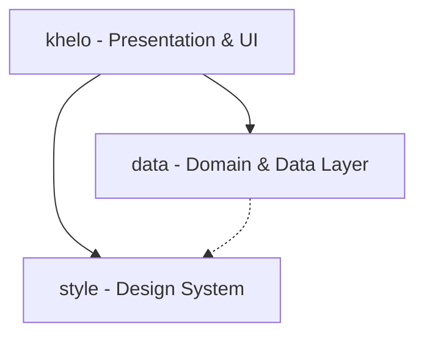
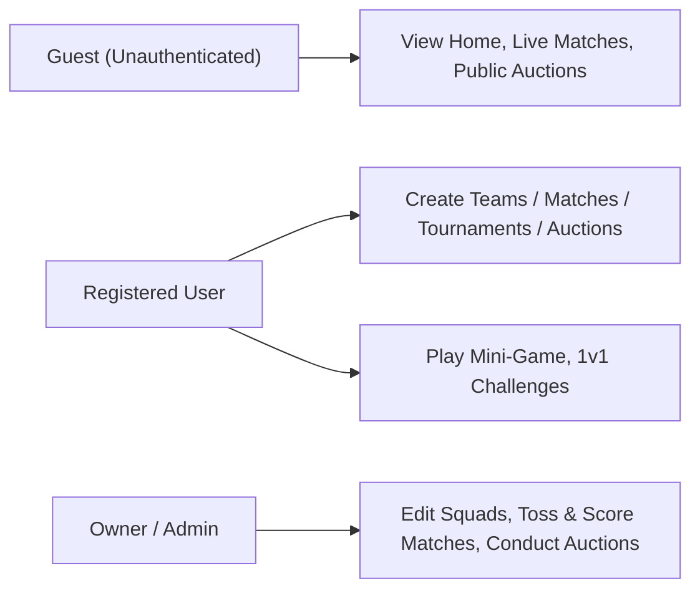

# Khelo (Sports Tamil) — Full Application Context

> **Project Identity:** Khelo / Sports Tamil 🏏  
> **Tagline:** *"From Streets to Stadiums"*  
> **Tech Stack:** Flutter (Multi-platform: Web, Android, iOS), Dart, Firebase (Firestore, Auth), Riverpod, GoRouter.

---

## 1. Executive Summary & Brand

**Khelo** is an open-source, multi-platform cricket management and gaming ecosystem originally built by Canopas and branded as **Sports Tamil**. It caters to grassroot cricket communities, tournament organizers, team managers, and passionate players.

### Key Value Propositions
- **Tournament & League Management:** Create and manage complex cricket tournaments (Knockout, Mini-Robin, Custom), team pools, squads, fixtures, points tables with Net Run Rate (NRR), and MVP rankings.
- **Ball-by-Ball Live Scoring:** Real-time scoring interface with wagon wheel, extras tracking, bowler/batter stats, commentary, partnerships, and match events.
- **Live Auction Rooms:** Real-time IPL-style auction engine with live bidding, timer, undo actions, budget caps, squad limits, and one-click tournament generation from auction rosters.
- **Play (Mini-Game & 1v1 Matches):** Built-in reflex timing cricket game with daily challenges, global leaderboards, and real-time head-to-head 1v1 multiplayer with server heartbeats.
- **Sports Tamil Tiger Mascot:** An interactive, animated Tamil-speaking mascot peeking from the screen edge with context-aware reactions (celebrating boundaries/wickets, reacting to sign-in, and dropping classic Tamil cinema one-liners on tap).

---

## 2. Monorepo Architecture

The workspace is organized as a clean architecture monorepo across three primary Flutter/Dart packages:

### Module Breakdown

| Package | Path | Purpose |
|:---|:---|:---|
| **khelo** | [`khelo/`](file:///Users/anu/Projects/khelo/khelo) | Main multi-platform app: UI screens, view models (`StateNotifier`), GoRouter navigation, app overlays, and localization. |
| **data** | [`data/`](file:///Users/anu/Projects/khelo/data) | Data and domain layer: Firestore services, API models, error definitions, and Firebase/external API integrations. |
| **style** | [`style/`](file:///Users/anu/Projects/khelo/style) | Reusable design system: buttons, typography, custom colors, theme configurations, shimmers, and the signature floating bottom nav. |
| **vault** | [`vault/`](file:///Users/anu/Projects/khelo/vault) | Obsidian-style technical documentation and knowledge base for feature workflows, schemas, and deployment notes. |

---

## 3. Technology Stack & Key Patterns

### State Management & Architecture
- **Riverpod (`StateNotifier`):** Screens pair a `*_screen.dart` with a corresponding `*_view_model.dart` and immutable state class.
- **Models:** Built primarily with `freezed` and `json_serializable`. Due to an issue with `build_runner`, newer models (such as Tournament Teams and extras) use handwritten plain Dart classes with explicit `copyWith` and JSON mappers.
- **Routing:** Powered by **GoRouter** in [`khelo/lib/ui/app_route.dart`](file:///Users/anu/Projects/khelo/khelo/lib/ui/app_route.dart). Routes pass screen builders via `extra`. Deep links with public URLs are supported for auctions (`/auction/:id`), tournaments, matches, and play matches.

### Design System & Navigation
- **Floating Bottom Bar:** A custom pill-style floating navigation bar (`AppBottomNavigationBar`) on Web and Android with fluid spring motion, active glowing indicator, and logo anchor. iOS retains native `CupertinoTabBar`.
- **Loading Strategy:** Full-page data loads use custom shimmer skeletons (`style/lib/indicator/shimmer.dart`). Small inline spinners (`AppProgressIndicator`) are reserved for buttons, bottom sheets, and uploads.
- **Localization & Tamil Mascot:** App interface is English (`app_en.arb`), while the mascot reads spoken Tamil lines from [`khelo/assets/locales/app_ta.arb`](file:///Users/anu/Projects/khelo/khelo/assets/locales/app_ta.arb) rendered using bundled **Noto Sans Tamil**.

---

## 4. User Roles & Permission Model

There is no universal super-admin. Permissions are scoped strictly at the document level:

| Role | How Granted | Permissions & Capabilities |
|:---|:---|:---|
| **Guest** | Not signed in | Browse home feed, view public match/tournament scorecards, spectate live auction rooms, and test the Play mini-game. |
| **User** | Signed in with profile | Create teams, start matches, create tournaments, manage personal stats, participate in 1v1 live games. |
| **Team Owner / Admin** | Creator or promoted admin | Add/remove players, assign roles, edit team details, generate QR codes. |
| **Match Scorer / Official** | Assigned when creating match | Run the live ball-by-ball score engine, declare toss, pause/end match. |
| **Tournament Admin** | Creator or organizer | Schedule fixtures, add team pools, manage rules, adjust points table. |
| **Auctioneer / Co-admin** | Auction creator or listed admin | Control live auction gavel, open/close bids, sell/unsold players, finalize auction. |

---

## 5. Core Feature Modules

### 1. Match Engine & Live Scoring
- **Setup:** Supports Limited Overs, Test Matches, and Custom formats with leather, tennis, or synthetic balls.
- **Real-Time Engine:** Tracks every delivery with runs, wickets, extras (wides, no-balls, byes, leg-byes), wagon wheel coordinate logging, bowler spell metrics, and fall of wickets.
- **Optimized Batch Loading:** To prevent N+1 Firestore queries, match lists load all teams and squad profiles in parallel batched queries (30 IDs per chunk) via `MatchService._withTeams`.

### 2. Tournaments & Team Pools
- **Structure:** Supports round-robin, knockout, and multi-stage pool tournaments.
- **Standings & NRR:** Automatically computes Net Run Rate (standard all-out full quota calculation) and points tables directly from ball-by-ball data.
- **Player Leaderboard & MVP:** Dynamically calculates top run scorers, highest wicket-takers, boundary counts, and proprietary MVP points.

### 3. Live Auction Engine
- **Workflow:** `Draft` → `Upcoming` → `Live` → `Paused` → `Completed`.
- **Live Room:** Supports real-time bidding trails, countdown timers, bidding increments, minimum/maximum squad quotas, and budget enforcement.
- **Public Spectating:** Anyone can view the auction room in real-time without signing in.
- **Auto Generation:** Finishing an auction generates a complete tournament (`tournaments/auction_<id>`), team pool, individual teams, and player profiles in a single transactional batch.

### 4. Play (Mini-Game & 1v1 Live Multiplayer)
- **Cricket Timing Game:** Batting mini-game with seed-based pitch generation, shot timing detection (Early/Perfect/Late), and daily challenges.
- **Real-Time 1v1 Live Matches:** Two online players can challenge each other to a live 1–5 over match with toss selection, turn-based batting/bowling, and 10-second presence heartbeats.

### 5. Player Claim & Phone Privacy
- **Privacy-First Indexing:** Phone numbers are never stored in public player documents. They are stored in `user_private/{uid}` and indexed via `phone_index` with `sha256('sportstamil:' + number)`.
- **Claiming Flow:** When an organizer creates unverified squad players, the real player can claim their profile upon registration by verifying their phone number and receiving organizer approval.

### 6. Interactive Tiger Mascot
- **Tamil Voice & Personality:** In-game tiger guide who appears on the right edge to cheer achievements, warn about errors, or guide new users through registration.
- **Easter Eggs:** Tapping the mascot triggers famous Tamil cinema dialogue quotes (Baasha, Padayappa, mass entry lines).

---

## 6. Firestore Database Architecture

| Collection | Schema Description & Purpose |
|:---|:---|
| [`users`](file:///Users/anu/Projects/khelo/data/lib/api/user/user_models.dart) | User and player profiles (name, email, role, batting/bowling style, inline photo). |
| `user_private` | Sensitive user details (`phone`, `updated_at`). Restricted strictly to doc owner. |
| `phone_index` | SHA-256 hashed phone lookups pointing to user IDs for claim resolution. |
| `player_claims` | Pending and approved claims between real users and organizer-created players. |
| [`teams`](file:///Users/anu/Projects/khelo/data/lib/api/team/team_model.dart) | Team rosters, player IDs, roles, and logo references. |
| [`matches`](file:///Users/anu/Projects/khelo/data/lib/api/match/match_model.dart) | Match metadata, toss results, team references, ball types, match status. |
| `innings`, `ball_scores` | Ball-by-ball telemetry, boundaries, extras, wagon wheel angles. |
| [`tournaments`](file:///Users/anu/Projects/khelo/data/lib/api/tournament/tournament_payload.dart) | Tournaments, fixtures, stages, overs, ball types, point systems. |
| `auctions`, `photos` | Auction settings, bidding history logs, and player auction portrait blobs. |
| `play_matches`, `play_presence` | Live 1v1 match sessions, current scores, and 60-second online user heartbeat. |

---

## 7. Current Project Status & Caveats

1. **Storage Workaround:** The external Supabase image storage endpoint is currently offline. As a fallback, profile images and auction player cards are stored directly as inline compressed images/blobs within Firestore.
2. **Build Runner:** `build_runner` code generation is inactive. New data models must be implemented as clean, standalone Dart classes without relying on automatic generator runs.
3. **Flutter Web Debug Performance:** Flutter Web in debug mode compiles via `dartdevc`, producing hundreds of modular script files. Production testing should be conducted with `flutter run -d chrome --release`.

---

## 8. Essential File Directory Map

* **Application Entry:** [`khelo/lib/main.dart`](file:///Users/anu/Projects/khelo/khelo/lib/main.dart)
* **App Shell & Providers:** [`khelo/lib/ui/app.dart`](file:///Users/anu/Projects/khelo/khelo/lib/ui/app.dart)
* **Route Definitions:** [`khelo/lib/ui/app_route.dart`](file:///Users/anu/Projects/khelo/khelo/lib/ui/app_route.dart)
* **Main Screen & Bottom Nav:** [`khelo/lib/ui/flow/main/main_screen.dart`](file:///Users/anu/Projects/khelo/khelo/lib/ui/flow/main/main_screen.dart)
* **Design System Components:** [`style/lib/`](file:///Users/anu/Projects/khelo/style/lib)
* **Data Services & APIs:** [`data/lib/service/`](file:///Users/anu/Projects/khelo/data/lib/service)
* **Firestore Security Rules:** [`khelo/firestore.rules`](file:///Users/anu/Projects/khelo/khelo/firestore.rules)
* **Mascot System:** [`khelo/lib/components/mascot/`](file:///Users/anu/Projects/khelo/khelo/lib/components/mascot)
